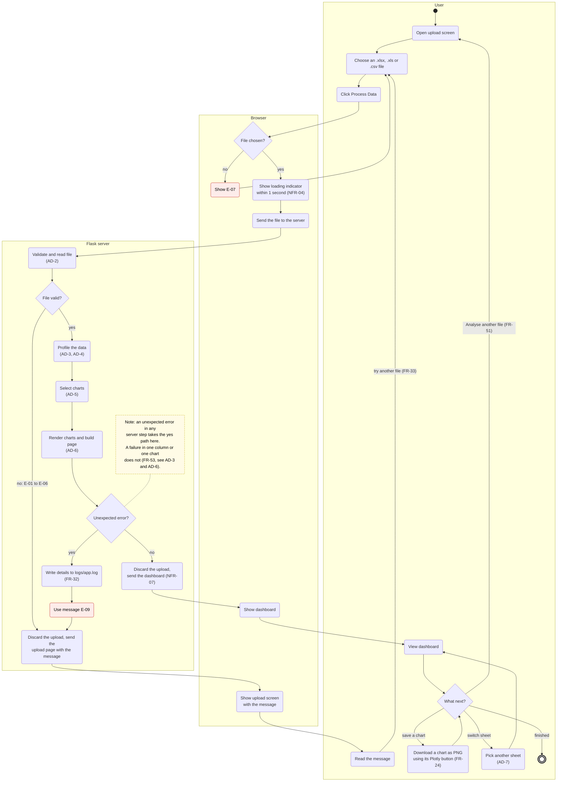
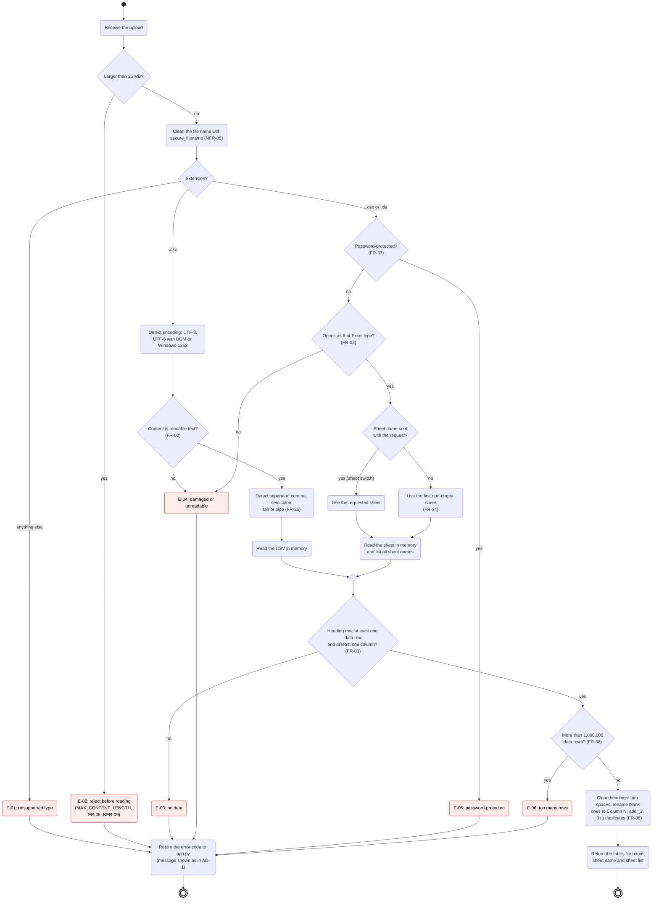
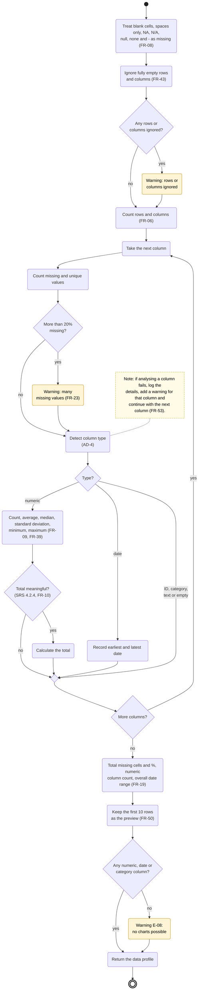
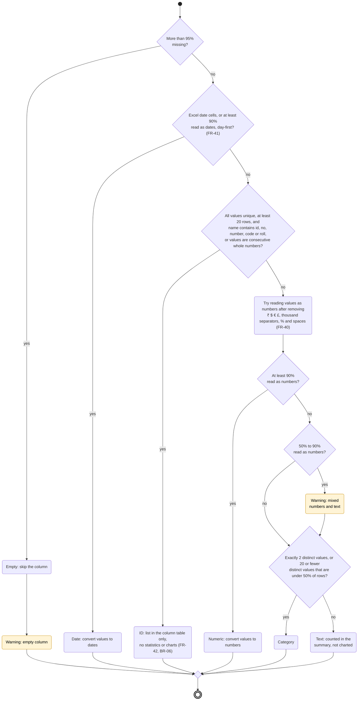
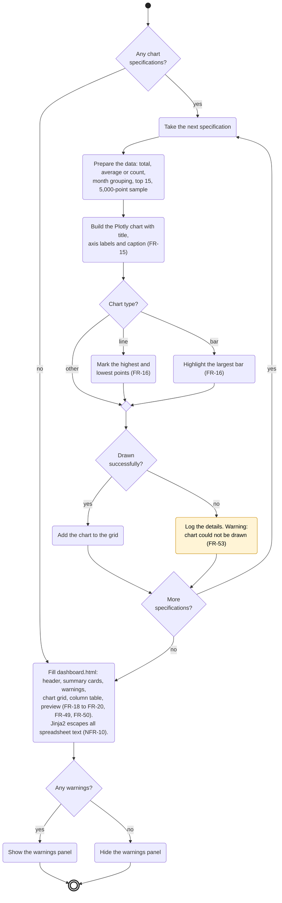
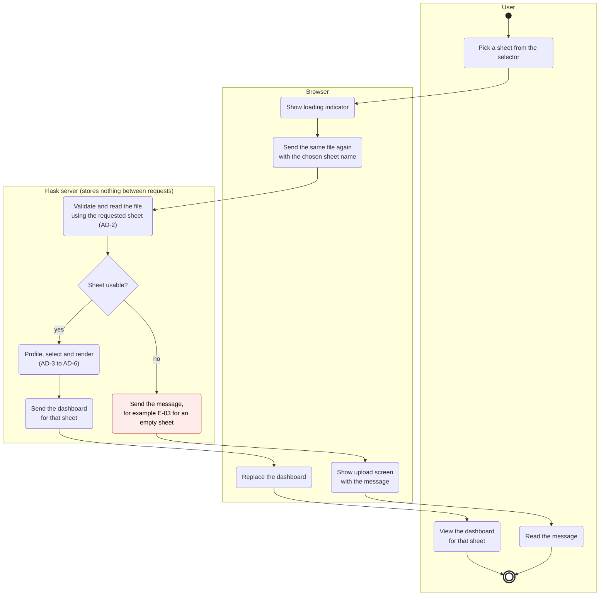
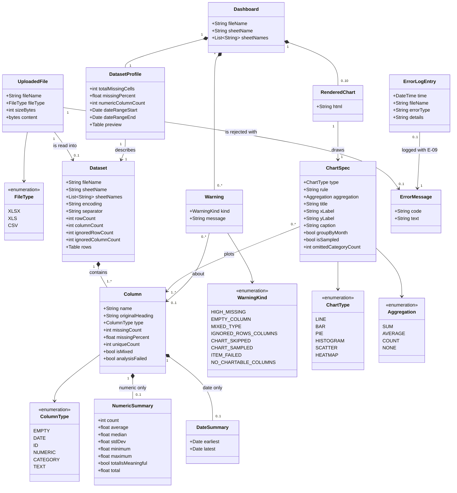
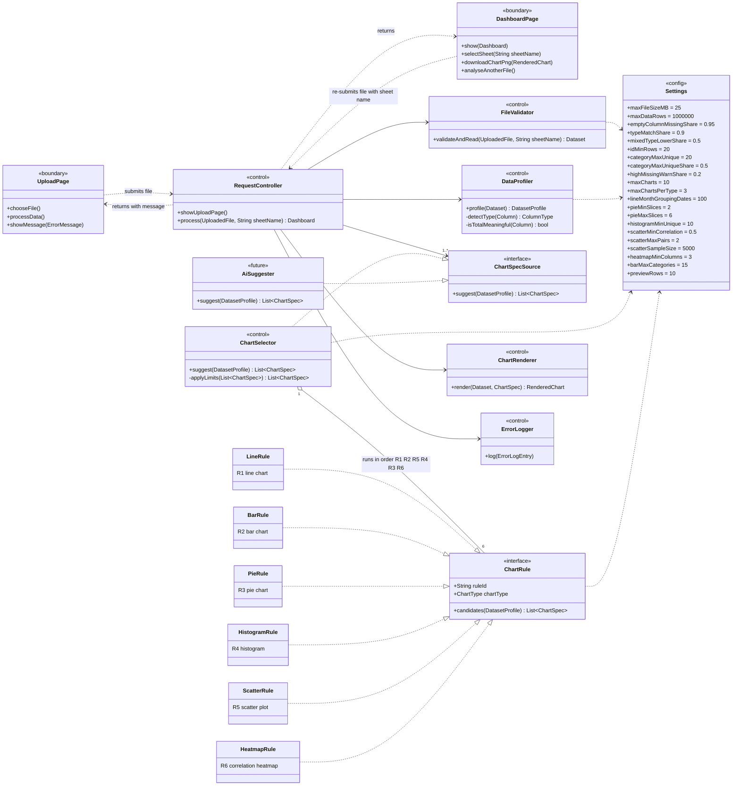

# Activity and Class Diagrams

## Automated Data Visualization Dashboard System

| | |
|---|---|
| Version | 0.1 |
| Date | 10 October 2026 |
| Based on | SRS v0.2 (`SRS_DataVisualisation_v0.2.md`) and `decisions.md` (entries dated 2026-10-10) |
| Status | Analysis models, drawn before building |

---

## 1. About This Document

The decisions log says to draw activity diagrams and an **analysis class diagram** before building. The **design class diagram** will be generated from the real code after it is built. This document holds the before-building models.

- **Activity diagrams (Section 2)** show the steps the system follows, including every decision and error path in the SRS.
- **Class diagrams (Section 3)** show the main things the system works with (entity classes) and the parts that do the work (boundary and control classes). They describe what the system needs, not the final code. The class names do not have to match the Python code.

Requirement IDs in brackets, such as (FR-34), show where each step comes from.

### 1.1 Notation

Mermaid has no UML activity diagram type, so the activity diagrams are Mermaid flowcharts drawn with UML activity conventions:

| Symbol | Meaning |
|---|---|
| Small filled circle | Start (initial node) |
| Double ring | End (final node) |
| Rounded box | Action |
| Diamond with a question | Decision; the labels on the arrows are the guard conditions |
| Empty diamond | Merge (paths join again) |
| Red box | User-facing error (codes from SRS Section 4.7.3) |
| Yellow box | A warning added to the dashboard's warnings panel |
| Dotted yellow box | Note |
| Labelled outer box | Swimlane: who carries out the actions inside it |

---

## 2. Activity Diagrams

| ID | Activity | Main requirements | Module (SRS 6.6) |
|---|---|---|---|
| AD-1 | Upload to dashboard (overview) | FR-01, FR-24, FR-32, FR-33, FR-51, NFR-04, NFR-07 | app.py, templates |
| AD-2 | Validate and read file | FR-01 to FR-05, FR-34 to FR-38, NFR-08, NFR-09 | validator.py |
| AD-3 | Profile the data | FR-06, FR-08, FR-09, FR-10, FR-23, FR-39, FR-43, FR-50, FR-53 | profiler.py |
| AD-4 | Detect column type | FR-07, FR-40, FR-41, FR-42 (SRS 4.2.3) | profiler.py |
| AD-5 | Select charts | FR-12 to FR-17, FR-44 to FR-48 (SRS 4.3.2, 4.3.3) | chart_rules.py |
| AD-6 | Render charts and build dashboard | FR-15, FR-16, FR-18 to FR-20, FR-23, FR-49, FR-50, FR-53, NFR-10 | renderer.py, app.py |
| AD-7 | Switch sheet | FR-34, US-05, decision of 2026-10-10 | app.py, dashboard.html |

### AD-1 Upload to Dashboard (Overview)

The main flow from choosing a file to using the dashboard. AD-2 to AD-6 expand the server's steps.

The Process Data button stays disabled until a file is chosen (SRS 3.1), so E-07 is a fallback.

### AD-2 Validate and Read File

What `validator.py` does with one upload. The uploaded file is only read, never changed (FR-11, NFR-05).

### AD-3 Profile the Data

What `profiler.py` does with the table returned by AD-2. Each column is analysed separately, so a problem in one column does not stop the rest.

### AD-4 Detect Column Type

The rules in SRS Section 4.2.3, applied to the non-missing values of one column in this order. The first rule that matches decides the type.

### AD-5 Select Charts

What `chart_rules.py` does with the data profile. It produces chart specifications (plain data), not drawings (SRS 6.6). Rules run in the priority order from SRS 4.3.3: R1, R2, R5, R4, R3, R6.

```mermaid
flowchart TD
    st((" ")):::startNode --> s0("Order category and numeric columns<br/>by fewest missing values (SRS 4.3.3)")
    s0 --> r1{"R1: a date column and<br/>a numeric column?"}
    r1 -->|yes| a1("Line spec: numeric total per date (average if a<br/>total is not meaningful), sorted by date.<br/>Group by month if more than 100 dates.")
    r1 -->|no| r2
    a1 --> r2{"R2: a category<br/>column?"}
    r2 -->|yes| a2("Bar spec per category column: total or average of a<br/>numeric column, or count if there is none. Highest first.<br/>More than 15 categories: top 15 plus a note (FR-46).")
    r2 -->|no| r5
    a2 --> r5{"R5: numeric pairs with correlation<br/>of 0.5 or more, either sign?"}
    r5 -->|yes| a5("Scatter spec for the 2 strongest pairs. More than<br/>5,000 rows: mark as a 5,000-point sample (FR-45).")
    r5 -->|no| r4
    a5 --> d5{"Sampled?"}
    d5 -->|yes| w5("Warning: sampled chart"):::warn
    d5 -->|no| r4
    w5 --> r4{"R4: a numeric column with<br/>at least 10 unique values?"}
    r4 -->|yes| a4("Histogram spec per such column,<br/>bins chosen automatically")
    r4 -->|no| r3
    a4 --> r3{"R3: a category column with 2 to 6 categories,<br/>counts or meaningful totals, no negative values?"}
    r3 -->|yes| a3("Pie spec (never more than<br/>6 slices: FR-14, BR-03)")
    r3 -->|no| r6
    a3 --> r6{"R6: 3 or more<br/>numeric columns?"}
    r6 -->|yes| a6("Correlation heatmap spec (FR-47)")
    r6 -->|no| l1
    a6 --> l1("Keep the first 10 candidates, at most<br/>3 of any one chart type (FR-44)")
    l1 --> d1{"Any candidates<br/>left out?"}
    d1 -->|yes| w1("Warning: skipped charts (FR-17)"):::warn
    d1 -->|no| l2
    w1 --> l2("Add a title, axis labels and a one-line<br/>caption to each spec (FR-15, FR-48)")
    l2 --> l3("Return the list of chart specifications")
    l3 --> en(((" "))):::endNode

    classDef startNode fill:#222,stroke:#222,color:#222
    classDef endNode fill:#fff,stroke:#222,stroke-width:3px,color:#fff
    classDef warn fill:#fff4d6,stroke:#c98a00,color:#000
```

A category column with 7 or more categories gets no pie chart. It is already covered by its bar chart from R2.

### AD-6 Render Charts and Build Dashboard

What `renderer.py` and `app.py` do with the chart specifications. A chart that fails to draw is listed in the warnings panel. It does not stop the dashboard.

### AD-7 Switch Sheet

From the decisions log (2026-10-10): the browser sends the same file again with the chosen sheet name. The server keeps nothing between requests.

---

## 3. Analysis Class Diagrams

Two views:

- **CD-1 Entity classes:** the information the system creates and passes along. All of it lives in memory for one request only (SRS 6.5).
- **CD-2 Boundary and control classes:** the screens (boundary) and the parts that do the work (control), and how they depend on each other.

### CD-1 Entity Classes

| Class | What it is | Requirements |
|---|---|---|
| UploadedFile | The file as received. Read only; never changed or saved. | FR-01, FR-05, FR-11, NFR-05, NFR-07 |
| Dataset | The table read from one sheet (or the CSV), with cleaned headings. | FR-06, FR-34, FR-35, FR-38, FR-43 |
| Column | One column with its detected type and quality counts. | FR-07, FR-08, FR-49 |
| NumericSummary | Statistics for a numeric column. `total` is only filled when `totalIsMeaningful` is true. | FR-09, FR-10, FR-39 |
| DateSummary | Earliest and latest date in a date column. | FR-19, FR-41 |
| DatasetProfile | Whole-file figures for the summary cards, plus the 10-row preview. | FR-19, FR-50 |
| Warning | One line in the warnings panel. | FR-17, FR-23, FR-45, FR-53, E-08 |
| ChartSpec | A decision to draw one chart: which rule, columns and aggregation. Plain data, no drawing. | FR-12 to FR-17, FR-44 to FR-48 |
| RenderedChart | The Plotly HTML for one chart, with its built-in PNG download. | FR-15, FR-16, FR-24 |
| Dashboard | Everything shown on the dashboard screen. | FR-18 to FR-21, FR-49 to FR-51 |
| ErrorMessage | A friendly message from the catalogue, E-01 to E-09. | FR-04, FR-30, SRS 4.7.3 |
| ErrorLogEntry | One technical entry in `logs/app.log`. Never shown to users. | FR-32 |

ID columns are `Column` objects with type `ID`. They have no `NumericSummary` and no `ChartSpec` ever refers to them (FR-42, BR-06).

### CD-2 Boundary and Control Classes

| Class | Stereotype | Module (SRS 6.6) | Requirements |
|---|---|---|---|
| UploadPage | boundary | templates/upload.html | SRS 3.1, FR-01, NFR-04 |
| DashboardPage | boundary | templates/dashboard.html, static/ | FR-18 to FR-24, FR-34, FR-49 to FR-51 |
| RequestController | control | app.py | FR-30, FR-33, NFR-07, NFR-09, NFR-11 |
| FileValidator | control | validator.py | FR-01 to FR-05, FR-34 to FR-38 |
| DataProfiler | control | profiler.py | FR-06 to FR-10, FR-39 to FR-43 |
| ChartSpecSource | interface | chart_rules.py | SRS 6.6 (a second source can be added later) |
| ChartSelector, ChartRule and R1 to R6 | control | chart_rules.py | FR-12 to FR-17, FR-44 to FR-48 |
| AiSuggester | future | not built yet | FR-27 to FR-29, FR-52, BR-05 |
| ChartRenderer | control | renderer.py | FR-15, FR-16, FR-24, FR-53 |
| ErrorLogger | control | app.py (Python logging) | FR-32 |
| Settings | config | config.py | NFR-16 (all thresholds in one place) |

Design notes:

- **ChartSpecSource** comes from SRS 6.6: chart rules return plain specifications, so a future AI feature can be a second source without changing the rest. `AiSuggester` is marked `<<future>>`. The core works without it (FR-27), and its suggestions are labelled and never replace rule-based charts (FR-29, BR-05).
- **One class per chart rule** keeps each rule testable on its own, without the web server (NFR-18). The real code may use plain functions. The design class diagram drawn after building will show what was actually built.
- **Settings** lists every threshold from SRS 4.2.3, 4.2.4, 4.3.2 and 4.3.3, so they can be adjusted after testing (Appendix D, open item 3) by changing one file.
- **RequestController** has no saved state. Each request carries the file, and the optional sheet name, from start to finish (decisions log, 2026-10-10).

---

## 4. Points to Confirm

The diagrams make the following choices where the SRS leaves room. Confirm or change them, then record the outcome in `decisions.md`.

1. **Wrong content for the extension** (for example, a PDF renamed to .csv). AD-2 shows E-04. FR-02 could also justify E-01, and TF-04 accepts either.
2. **Charts left out by the 10-chart limit.** AD-5 lists them as "skipped charts" in the warnings panel (FR-17). The other option is to list only charts that failed or did not suit the data.
3. **Errors while switching sheets** (for example, the chosen sheet is empty). AD-7 returns to the upload screen with the message, like any other error. The other option is to keep the current dashboard and show the message on it.
4. **Keeping the file for a sheet switch.** The browser can only send the file again if the page still holds it. That means the upload screen sends the file with JavaScript and swaps in the dashboard, instead of a normal form post that loads a new page. This affects Sprint 3 (FR-34 sheet selector).
