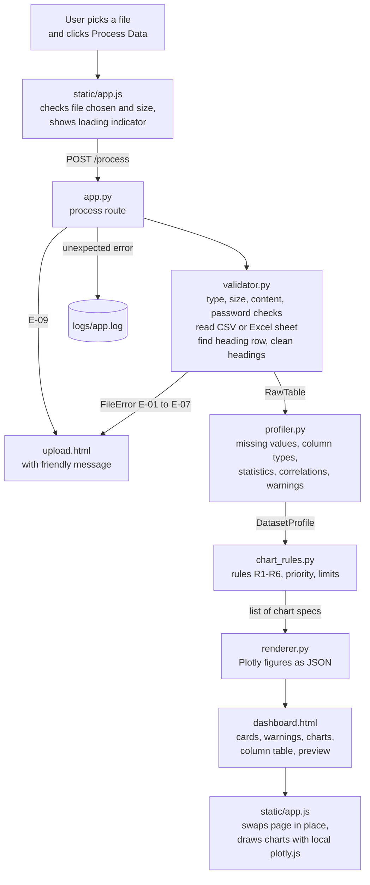

# Progress Report

## Automated Data Visualization Dashboard System

| | |
|---|---|
| **Report date** | 10 October 2026, updated 15 October 2026 after Phase 1 |
| **Requirements baseline** | SRS v0.3 (`docs/SRS_DataVisualisation_v0.3.md`); sections 2–11 below were written against v0.2 |
| **Code state** | Working application, 177 automated tests passing |

## Phase log

### Phase 1 — Decisions and SRS v0.3 (15 Oct 2026) — done

| Item | Outcome |
|---|---|
| SRS v0.3 | New file `docs/SRS_DataVisualisation_v0.3.md`, trimmed (diagrams appendix, reading guide and most of the glossary removed). v0.2 kept |
| Repeating IDs (FR-54, rule 3b) | Whole-number columns whose heading's last word is `id, no, number, code, roll, key, seq` (or first word `id`) are IDs even when values repeat. Listed in warnings as "Treated as IDs, so not added up or charted: …" |
| Row-count line (FR-55, R1) | With a date column but no number column, R1 draws "Number of rows by month/over time" |
| Category rule (rule 5) | 20-value cap removed: a column is a category when its values repeat (unique values < 50% of rows). TF-08 now gets its top-15 bar |
| Title rows (FR-56) | A single-cell title row above wider headings is skipped |
| TF-05 | Uses € and £ (₹ cannot be stored in Windows-1252) |
| New test files | TF-17 (change history with repeating IDs), TF-18 (Excel title row) |
| Section 9 interpretations | All accepted and written into SRS v0.3 (interpretation 1 replaced by the new ID-heading rule) |
| Section 10 problems | 1, 2 and 4 fixed in v0.3. 3 (pies/heatmaps rarely shown) deferred: SRS v0.3 Appendix C, item 3. 5 (noisy warning) moved to the UI/UX phase |
| Decisions log | Sheet-switching and Waitress decisions moved into the SRS; hosting and diagram-timing entries remain |
| Tests | 142 → 177, all passing |

---

## Contents

1. [Summary](#1-summary)
2. [How the system works](#2-how-the-system-works)
3. [Setup and running](#3-setup-and-running)
4. [What each file does](#4-what-each-file-does)
5. [Requirement coverage](#5-requirement-coverage)
6. [Automated tests](#6-automated-tests)
7. [Manual checks done so far](#7-manual-checks-done-so-far)
8. [Performance measurements](#8-performance-measurements)
9. [Interpretations that need your confirmation](#9-interpretations-that-need-your-confirmation)
10. [Problems found in the SRS](#10-problems-found-in-the-srs)
11. [Not done yet and known limitations](#11-not-done-yet-and-known-limitations)
12. [Proposed phases from here](#12-proposed-phases-from-here)

---

## 1. Summary

The whole first-release pipeline from SRS v0.2 is built and works end to end: upload → validate → read → clean and classify columns → calculate statistics → choose charts by rules R1–R6 → draw charts → show the dashboard.

**One process note.** The SRS plans this work over four sprints (Section 6.1). The code was written in a single pass that covers the Sprint 1–4 requirements together, before the phase-by-phase way of working was agreed. From now on, work will go one phase at a time (Section 12). The table below shows which sprint each part belongs to, so the sprint reviews can still follow the SRS plan.

| SRS sprint | Goal | Where it lives | State |
|---|---|---|---|
| 1 | Upload, validation, reading files | `validator.py`, `config.py`, upload limits in `app.py` | Built and tested |
| 2 | Column detection, statistics, chart rules | `profiler.py`, `chart_rules.py`, `renderer.py` | Built and tested |
| 3 | Dashboard and multiple charts | `templates/`, `static/`, `app.py` | Built; server side tested; browser checks partly done |
| 4 | Error handling, testing, performance | logging and error pages in `app.py`, `tests/` | Built and tested; manual timing, browser and user tests still to do |
| Later | FR-22, FR-25, AI (FR-27 to FR-29, FR-52) | — | Not started (Backlog / Future in the SRS) |

**Numbers at a glance**

| Item | Value |
|---|---|
| Application code | 6 Python modules, 3 HTML templates, 1 JavaScript file, 1 CSS file (≈ 1,870 lines) |
| Test code | 5 test modules, 1 test-file generator, 1 shared fixture file (≈ 1,100 lines) |
| Automated tests | 142, all passing, about 12–14 s for the full run (NFR-18 limit: 60 s) |
| TF-10 (50,000 rows × 30 columns) | Processed in 3.8 s on this laptop (NFR-01 limit 30 s, target 10 s) |
| Functional requirements built | All first-release FRs, except Backlog/Future items FR-22, FR-25, FR-28, FR-29, FR-52 |

---

## 2. How the system works

### 2.1 Request flow



### 2.2 The data passed between modules

| From → To | Object | What it holds |
|---|---|---|
| `validator` → `profiler` | `RawTable` | File name and kind, sheet name and all sheet names, CSV encoding and separator, the data rows as original cell values (headings already cleaned), and the number of empty rows/columns ignored |
| `profiler` → `chart_rules` | `DatasetProfile` | Row and column counts, missing-cell totals, one `ColumnProfile` per column (type, missing, unique, stats, unit, date range), cleaned values of chartable columns, the correlation matrix, preview rows, warnings |
| `chart_rules` → `renderer` | list of `dict` | One plain-data specification per chart (see 4.4). No drawing |
| `renderer` → template | list of `RenderedChart` | Chart id, type, title, caption, note, Plotly figure as script-safe JSON, PNG download name |

Keeping `chart_rules` output as plain data follows SRS 6.6. It means rules are tested without drawing anything, and a future AI feature could add specs without touching the rest.

### 2.3 Sheet switching (decisions log, 10 Oct 2026)

The server stores nothing between requests. `app.js` keeps the chosen `File` object in browser memory. When the user picks another sheet, it posts the same file again with the sheet name. The page content is replaced in place rather than by navigating to a new page, so the `File` object survives.

---

## 3. Setup and running

| Step | Command |
|---|---|
| Install app dependencies | `pip install -r requirements.txt` |
| Install test dependencies too | `pip install -r requirements-dev.txt` |
| Start the app | `python app.py`, then open http://127.0.0.1:5000 |
| Run all tests | `python -m pytest` |
| Write the test file set to disk | `python tests/make_test_files.py` (writes into `tests/files/`) |

Installed and verified on this machine: Python 3.13.5, pandas 3.0.2, numpy 2.4.4, Flask 3.1.3, plotly 7.1.0, xlrd 2.0.2, pytest 9.1.1, plus python-calamine, openpyxl, waitress, xlwt and msoffcrypto-tool. The packages live in the global Python install; no virtual environment is used.

---

## 4. What each file does

### 4.1 `config.py` — all settings in one place (NFR-16)

Holds every threshold and fixed value, so chart rules and limits can be changed without touching logic. Nothing else in the code hard-codes these numbers.

| Group | Settings |
|---|---|
| Server | `HOST = 127.0.0.1` (NFR-11), `PORT = 5000` |
| Log | `LOG_FILE = logs/app.log`; can be redirected with the environment variable `DASHBOARD_LOG_FILE` (the tests use this so they don't write into the real log) |
| Upload | Supported extensions; `MAX_FILE_BYTES` = 25 MB; `MAX_REQUEST_BYTES` = 25 MB + 64 KB (room for the form wrapping around the file); `MAX_DATA_ROWS` = 1,000,000; CSV separators `, ; tab |` |
| Cleaning | Missing-value words (`"", na, n/a, null, none, -`); the characters removed before reading a number (`₹ $ € £ % , spaces`); the 21 text date formats, day-first |
| Column types (4.2.3) | 95% empty rule, 90% date rule, ID needs 20 rows and the words `id, no, number, code, roll`, 90% numeric rule, 50% "mixed" threshold, category ≤ 20 values and < 50% of rows, 20% high-missing warning |
| Totals (4.2.4) | Year range 1900–2100; no-total words `rate, ratio, avg, average, mean, age`; no-total text `%`, `percent` |
| Charts (4.3) | 10 charts max, 3 per type, monthly grouping above 100 dates, top 15 bars, pie 2–6 slices, histogram ≥ 10 values and ≤ 60 bins, scatter ≥ 0.5 correlation, 2 pairs, 5,000 points, fixed random seed, heatmap ≥ 3 numeric columns |
| Dashboard | 10 preview rows |
| Messages | The exact texts of E-01 to E-09 from SRS 4.7.3 |

### 4.2 `validator.py` — file checks and reading (SRS 4.1, Sprint 1)

Turns uploaded bytes into a `RawTable`. It only reads the bytes in memory, so the original file can't be changed (FR-11, NFR-05).

**Main entry: `read_upload(file_name, content, sheet=None)`.** Checks run in this order:

1. **Extension** must be `.xlsx`, `.xls` or `.csv`, in any letter case. Otherwise **E-01** (FR-01, BR-01).
2. **Size** over 25 MB → **E-02** (FR-05). The server also enforces this before reading the request (see `app.py`).
3. **Empty file** (0 bytes or only whitespace) → **E-03** (FR-03, TF-02).
4. **Content check** (`_detect_kind`, FR-02). The extension alone isn't trusted:
   - A `.csv` that starts with a PDF, zip, Office, PNG, JPEG, GIF, RAR or 7z signature, or that contains NUL bytes, is not text → **E-01** (TF-04).
   - An Excel file in an OLE container that holds an `EncryptionInfo` stream is a password-protected `.xlsx` → **E-05** (FR-37, TF-13). Any other OLE container is treated as legacy `.xls`.
   - A zip file must contain `xl/` parts. A Word document or other zip renamed to `.xlsx` → **E-01**. A truncated or corrupt zip → **E-04**.
   - Anything else named `.xlsx`/`.xls` → **E-01**.
5. **Read** the file as CSV or Excel (below).
6. **Build the table** (`_build_table`), which applies the shared heading and empty-row rules.

**CSV path (`_read_csv`, FR-35)**
- `_decode` tries UTF-8 with BOM, then UTF-8, then Windows-1252. If none works → **E-04**. The encoding name is recorded.
- `_detect_separator` runs `csv.Sniffer` on the first 64 KB, limited to `, ; tab |`. If the sniffer can't decide, it scores each candidate by how many of the first 50 lines have the same number of fields as the first line.
- pandas reads every cell as text with `header=None`, so headings and missing values are handled by our own rules, not pandas' defaults. pandas would otherwise treat `NA` as missing and rename duplicate headings as `Sales.1`.
- If rows have different numbers of fields, pandas fails; `_read_ragged_csv` then reads with Python's `csv` module and pads short rows.

**Excel path (`_read_excel`, FR-34)**
- `_open_workbook` opens `.xlsx` with python-calamine and falls back to openpyxl. `.xls` is opened with xlrd, as SRS 3.3 specifies. An error mentioning "encrypt" or "password" → **E-05**; any other failure → **E-04**.
- If the user chose a sheet that exists, only that sheet is read. Otherwise sheets are tried in order, and the first one with a heading row and at least one data row is used. If none qualifies → **E-03**. The sheet name and the full list of sheet names are recorded for the selector.

**`_build_table` (FR-03, FR-36, FR-38, FR-43)**
- Marks missing cells with `missing_mask`.
- The first row with any non-missing cell is the heading row (SRS 2.7). Rows above it are skipped.
- Completely empty data rows are dropped and counted.
- A column with a blank heading **and** no data is dropped and counted.
- No data rows or no columns left → **E-03** (TF-03). More than 1,000,000 data rows → **E-06**.
- `clean_headings` trims headings, renames blanks to `Column N` (N = position in the file), and adds `_2`, `_3` to duplicates (TF-14).

**Shared helpers used elsewhere**
- `missing_mask(column)` applies the FR-08 rule: blank, spaces only, or `NA`, `N/A`, `null`, `none`, `-` in any case.
- `cell_text(value)` shows a cell the way a user expects:
  - whole-number floats without `.0`
  - dates as `YYYY-MM-DD`, with the time added only when it isn't midnight
  - booleans as `TRUE`/`FALSE`

  It's used for headings, the data preview and category labels.
- `FileError(code, cause)` is the exception for user-fixable problems. `.message` returns the catalogue text. `cause` keeps the technical error so it can be logged.

### 4.3 `profiler.py` — cleaning, column types, statistics, warnings (SRS 4.2, Sprint 2)

Works on a copy of the values. Produces a `DatasetProfile`.

**Data classes**
- `ColumnProfile`: name, position, type, missing count and %, unique count, mixed flag, unit, plus:
  - for numeric columns: count, total, whether a total is meaningful, mean, median, standard deviation, min, max
  - for date columns: earliest, latest, number of distinct days

  `type_label` gives the user-facing name (Number, Date, Category, Text, ID, Empty, Not analysed).
- `DatasetProfile`: dataset-level figures, the column profiles, the cleaned chart values (`values`), the correlation matrix, preview rows and warnings. Helpers:
  - `columns_of(type)` lists the columns of one type, fewest missing first (SRS 4.3.3)
  - `column(name)` finds one column
  - `numeric_count` counts numeric columns
  - `date_range` gives the date column used on the summary card
- `DataWarning(kind, message)` is one line in the warnings panel.

**`profile(table)`** runs `profile_column` on every column. Each call is wrapped so that if one column fails, it is logged, shown as "Not analysed", and the rest continue (FR-53, NFR-15). It then totals missing cells (FR-08), counts rows and columns (FR-06), builds the 10-row preview from the original values (FR-50) and calculates correlations.

**`profile_column`** applies the SRS 4.2.3 rules in order, on non-missing values:

| Order | Type | How it's checked in code |
|---|---|---|
| 1 | Empty | More than 95% missing |
| 2 | Date | `to_dates`: real Excel date cells, plus text matched against the 21 formats in `config.DATE_FORMATS`, day-first (FR-41). ≥ 90% must be dates. A 200-value sample is tried first, so text columns skip the full date parse |
| 3 | ID | At least 20 rows, all non-missing values unique, **and** either a heading word from `id, no, number, code, roll` or values that are consecutive whole numbers in any order (FR-42) |
| 4 | Numeric | `to_numbers`: real numbers, plus text with `₹ $ € £ % , spaces` removed (FR-40). ≥ 90% must be numbers |
| 5 | Category | Exactly 2 different values, or ≤ 20 values and fewer than 50% of rows |
| 6 | Text | Everything else |

- **Mixed columns.** When 50–90% of values are numbers, the column is flagged "mixed numbers and text".
- **Numeric statistics (`_numeric_stats`).**
  - Calculated: count, mean, median, sample standard deviation (same as Excel `STDEV.S`), min and max (FR-09, FR-39).
  - The total is calculated only when `total_is_meaningful` allows it (SRS 4.2.4, FR-10).
  - ID columns get no statistics at all (BR-06).
- **Units (`_unit`).** If most text values carried `%` or a currency symbol, that symbol becomes the column's unit. It's used in axis labels: "units where known", FR-15.
- **Heading words (`_name_words`).** Splits headings into words, so `OrderID` → order, id; `Roll_No.` → roll, no; `IDNumber` → id, number. These words are used for the ID and no-total rules (see interpretation 1 in Section 9).
- **Correlations (`_correlations`).** Pearson correlations between numeric columns, used by R5 and R6. If the calculation fails, a warning is added.
- **Warnings (FR-23, FR-43).** Raised for:
  - completely empty rows and columns that were ignored
  - almost-empty columns
  - columns with more than 20% missing
  - mixed columns
  - columns that failed analysis

### 4.4 `chart_rules.py` — which charts to make (SRS 4.3, Sprint 2)

Decides charts and returns plain specifications. It draws nothing. Example spec:

```json
{"type": "line", "rule": "R1", "x": "Order Date", "y": "Sales", "agg": "sum", "group": "day",
 "title": "Total Sales over time", "x_label": "Order Date", "y_label": "Total Sales",
 "caption": "Shows how total Sales changes over Order Date.", "id": "chart-1"}
```

**`select_charts(profile)`** runs the rules in the SRS 4.3.3 order: R1 → R2 → R5 → R4 → R3 → R6. Each rule is wrapped so that if one fails, the others still run (FR-53). It then applies the limits, numbers the charts `chart-1`, `chart-2`, …, and adds the **E-08** warning when no column holds numbers, dates or categories.

| Function | Rule | What it does |
|---|---|---|
| `line_charts` | R1 | Uses the date column with the fewest missing values, paired with each numeric column in turn. Totals per date, or averages if a total isn't meaningful. Groups by month above 100 distinct dates. Skips with a warning when there's no numeric column or only one date |
| `bar_charts` | R2 | For each numeric column (fewest missing first), one bar chart per category column, so the main number is shown against every category first. With no numeric column it counts rows. Adds a "top 15 of N" note above 15 categories (FR-46) |
| `scatter_charts` | R5 | Pairs with \|correlation\| ≥ 0.5, strongest 2 only. If a pair has more than 5,000 rows, it marks the spec for a 5,000-point sample and adds a note and a warning (FR-45) |
| `histograms` | R4 | Each numeric column with ≥ 10 different values. Columns with fewer are listed in one warning |
| `pie_charts` | R3 | Category columns with 2–6 values. Uses the main numeric column's total when that total is meaningful and never negative, otherwise row counts. Larger categories get a "bar chart used instead" warning (FR-14, BR-03) |
| `heatmaps` | R6 | One correlation heatmap when there are ≥ 3 numeric columns (FR-47) |
| `apply_limits` | 4.3.3 | Keeps the first 10 candidates with at most 3 per type (FR-44). Charts left out are summarised in one warning |

Every spec gets a title, axis labels with units, and a one-line caption explaining why it was chosen (FR-15, FR-48).

### 4.5 `renderer.py` — drawing the charts (Sprint 2/3)

Turns each spec into a Plotly figure and formats numbers and dates for the page.

**`render_charts(specs, profile)`** draws each chart in its own `try`:
- A chart whose columns turn out to have no usable rows is skipped with a warning (`NothingToDraw`, FR-17).
- Any other failure is logged and reported as "could not be drawn", and the remaining charts are still drawn (FR-53).

| Function | Chart | Details |
|---|---|---|
| `line_figure` | Line | Totals or averages per day or month. The highest and lowest points get larger markers and "Highest: …" / "Lowest: …" labels (FR-16) |
| `bar_figure` | Bar | Sorted largest first, top 15. The largest bar is blue and the rest are grey, and only the largest bar carries a value label (FR-16) |
| `pie_figure` | Pie | At most 6 slices in the fixed palette order, with labels and percentages on the slices and a legend |
| `histogram_figure` | Histogram | Bins are counted on the server with `bin_count`, which takes the larger of the Sturges and Freedman–Diaconis bin counts, capped at 60. Only the bin counts are sent to the browser, not every value |
| `scatter_figure` | Scatter | Draws the random 5,000-point sample when the spec asks for it (fixed seed, so the same file gives the same picture) |
| `heatmap_figure` | Heatmap | Blue for together, red for opposite, grey midpoint. Values are printed in the cells when there are ≤ 12 columns |

**Safety (NFR-10).**
- All spreadsheet text placed in a chart is HTML-escaped by `_text`, so `<script>` shows as text.
- Hover text also stops `%{` in a heading being read as a Plotly template field (`_hover`).
- The figure JSON has `<`, `>` and `&` escaped (`_script_safe_json`), so it can never close the `<script>` element it sits in.

**Look.**
- Charts use a colour-blind-checked reference palette: blue for single series, the fixed categorical order for pie slices, and blue↔red with grey for the heatmap.
- Gridlines are thin, the background is light, and the font is the system font.

**Formatting.**
- `format_number` adds thousand separators, gives 2 decimal places (whole numbers get none, NFR-14), and shows "—" for no value.
- `format_date` shows dates as `05 Jan 2026`.
- `CHART_HELP` holds the help text for each chart type (SRS 2.6).

### 4.6 `app.py` — Flask routes (Sprint 1/3/4)

| Part | What it does |
|---|---|
| `InMemoryRequest` | Replaces Flask's request class so uploaded files are held in memory rather than in Werkzeug's temporary files on disk (NFR-07) |
| `create_app()` | Sets `MAX_CONTENT_LENGTH`, so oversized requests are refused before they are read (NFR-09). Registers the `number` and `date` template filters, sets up logging, and gives every template the message texts and the size limit |
| `GET /` | Upload page |
| `POST /process` | No file → **E-07** (400). Cleans the file name, reads the sheet choice, then runs validator → profiler → chart_rules → renderer. A `FileError` → upload page with that message (400, or 413 for E-02); technical causes are logged. Any other exception → full traceback logged, **E-09** shown (500), with no technical text on the page (FR-32). On success, the processing time is logged and `dashboard.html` is rendered |
| `GET /vendor/plotly.min.js` | Serves the plotly.js file that ships inside the installed plotly Python package, so charts work offline (SRS 2.5). It is cached by the browser for a week |
| 413 handler | Shows **E-02** when Flask refuses an oversized request |
| `clean_file_name` | Applies `secure_filename` (NFR-08). If that strips the extension, as with a name in Devanagari only, the name becomes `uploaded_file.csv` |
| `_setup_logging` | Writes to `logs/app.log`: time, level and message, with tracebacks for errors. The file rotates at 1 MB and keeps 3 old copies (FR-32) |
| `python app.py` | Runs Waitress on 127.0.0.1:5000 (NFR-11, decisions log). Waitress is set to keep request bodies in memory. If Waitress isn't installed, it falls back to Flask's development server |

### 4.7 `templates/` — the pages (SRS 3.1, Sprint 3)

Jinja2 escapes everything by default, so headings and cell values from the file are always shown as text (NFR-10).

| File | Content |
|---|---|
| `base.html` | Shared page shell: stylesheet, the local plotly.js, and `app.js`. Passes the process URL, the size limit and the E-02/E-07/E-09 texts to the script through `data-` attributes on `<body>`. Contains the loading overlay |
| `upload.html` | Project name, one-line description, a file picker limited to `.xlsx, .xls, .csv`, the note "Maximum 25 MB. The first row must contain column headings.", the error area, the **Process Data** button and a privacy line |
| `dashboard.html` | The SRS 3.1 sections, top to bottom (see the list below) |

The dashboard sections are:
1. **Header:** file name, the sheet selector when there are several sheets (otherwise the sheet name), and **Analyse another file** (FR-18, FR-34, FR-51).
2. **Summary cards:** rows, columns, missing cells (count and %), number columns, and date range with its column name (FR-19).
3. **"Things to check" warnings panel:** hidden when there are no warnings (FR-23).
4. **Chart grid:** each chart has a caption and an optional note. A "How to read these charts" help section covers only the chart types shown and explains the PNG button (FR-24, FR-48).
5. **Column table:** name, type, missing (count and %) and unique values (FR-49). It also shows total, average, median, smallest, largest and standard deviation, so the FR-09/FR-10/FR-39 statistics are visible, plus a note on why some totals are left out.
6. **Data preview:** the first 10 rows (FR-50).

### 4.8 `static/` — browser side (Sprint 3)

**`app.js`**
- Keeps **Process Data** disabled until a file is chosen (SRS 3.1).
- Checks for a missing file (E-07) and an oversized file (E-02) before uploading, which saves a 25 MB upload. The server checks both again.
- Shows the loading overlay at the moment of clicking (NFR-04), and disables the buttons while waiting.
- Posts the file with `fetch` and swaps the server's response into the page in place, keeping the `File` object for sheet switching (FR-34). This works the same for a dashboard and for an upload page showing an error.
- Draws each chart from its JSON with Plotly, using these settings:
  - the toolbar is always visible
  - the **camera button saves a PNG** named after the chart title, at double resolution (FR-24)
  - charts resize with the window
- If one chart fails in the browser, only that chart shows "This chart could not be shown" (FR-53).
- The browser **Back** button from a dashboard returns to the upload screen.

**`style.css`**
- Colour and spacing tokens and the upload card.
- The loading spinner, which slows down when the user's system asks for reduced motion.
- Summary cards and the warnings panel.
- The chart grid: **two charts per row at 1200 px and wider, one per row below** (FR-20).
- Tables in their own horizontal scroll box, so a wide file never makes the page scroll sideways (FR-21).
- Coloured type badges and visible keyboard focus.

### 4.9 Project files

| File | Purpose |
|---|---|
| `requirements.txt` | App libraries: flask, pandas, plotly, python-calamine, openpyxl, xlrd, waitress |
| `requirements-dev.txt` | Adds pytest, plus xlwt and msoffcrypto-tool, which are only used to *create* TF-12 (.xls) and TF-13 (password-protected) |
| `pytest.ini` | Tells pytest where the tests are and lets them import the app modules |
| `logs/app.log` | Created on first run. Holds the entries from the manual server check (Section 7) |

### 4.10 `tests/` — automated tests and the test file set (SRS 6.4)

| File | What it contains |
|---|---|
| `make_test_files.py` | Builds all 16 SRS test files (TF-01 to TF-16) in code, so they are always available and reproducible. Run it directly to write them into `tests/files/` for manual checks |
| `conftest.py` | Points logging at a temporary file during tests. Provides the shared fixtures `tf` (get a test file), `profile_csv` (profile CSV text without the server, NFR-18) and `tf_profile` (profile a test file once per run and reuse it) |
| `test_validator.py` | 40 tests: file types, renamed and damaged files, empty files, size and row limits, passwords, encodings and separators, quoted values, ragged rows, sheet choice, `.xls`, heading cleanup, empty rows/columns, original file unchanged (hash check) |
| `test_profiler.py` | 34 tests: TF-01 statistics checked against an independent calculation, missing-value words, number cleaning, units, day-first dates, each type rule, ID detection (TF-09), the total rule, TF-07 messy file, preview, failure isolation, correlations |
| `test_chart_rules.py` | 30 tests: TF-01 chart set, priority order, titles and captions, the 10-chart and 3-per-type limits, fewest-missing-first, monthly grouping, average vs total, top-15 note, pie 4 vs 12 values, pie with negative values, histogram threshold, scatter pairs and sampling, heatmap threshold, ID never charted, E-08, failure isolation |
| `test_renderer.py` | 13 tests: titles and axis labels on every chart, highest/lowest markers, largest bar highlighted, only 15 bars drawn, 5,000-point scatter, histogram bin cap, script text escaped (TF-15), failure isolation, number formatting |
| `test_app.py` | 25 integration tests through Flask's test client: upload page, local plotly.js, TF-01 dashboard figures, every error message with its status code, no technical text, retry after error, sheet selector and switching (TF-06), warnings (TF-07), XSS (TF-15), text-only file (TF-16), TF-10 under 30 s, forced error written to the log, file-name cleaning, in-memory uploads |

---

## 5. Requirement coverage

**Legend:**
- **Done**: built and checked by automated tests.
- **Built**: built, but a manual check is still owed.
- **—**: not started (Backlog or Future in the SRS).

### 5.1 Functional requirements

| ID | Requirement (short) | State | Where | Checked by |
|---|---|---|---|---|
| FR-01 | Choose .xlsx/.xls/.csv | Done | `upload.html`, `validator.read_upload` | test_validator, TF-12 |
| FR-02 | Reject wrong types by extension and content | Done | `validator._detect_kind` | TF-04, renamed-file tests |
| FR-03 | Heading row, ≥ 1 data row, ≥ 1 column | Done | `validator._build_table` | TF-02, TF-03 |
| FR-04 | Simple message when unreadable | Done | `FileError`, `config.MESSAGES` | test_app |
| FR-05 | 25 MB limit before loading | Done | `MAX_CONTENT_LENGTH`, `read_upload` | TF-11 |
| FR-06 | Count rows and columns | Done | `profiler.profile` | TF-01 |
| FR-07 | Classify column types | Done | `profiler.profile_column` | type rule tests, TF-07 |
| FR-08 | Missing values incl. NA, N/A, null, none, - | Done | `validator.missing_mask` | test_profiler |
| FR-09 | Count, average, min, max | Done | `profiler._numeric_stats` | TF-01 |
| FR-10 | Totals only when meaningful | Done | `profiler.total_is_meaningful` | 9 parametrised cases |
| FR-11 | Original file never changed | Done | in-memory only | hash test |
| FR-12 | Rules R1–R6 | Done | `chart_rules` | test_chart_rules |
| FR-13 | More than one chart | Done | `chart_rules` | TF-01 |
| FR-14 | No pie above 6 categories | Done | `pie_charts` | pie tests, TF-08 |
| FR-15 | Titles, labelled axes, units | Done | specs and `_layout` | test_renderer |
| FR-16 | Mark highest/lowest, highlight largest bar | Done | `line_figure`, `bar_figure` | test_renderer; seen in screenshot |
| FR-17 | Skip unsuitable charts, list them | Done | rule warnings, `NothingToDraw` | several tests |
| FR-18 | File name and sheet name | Done | `dashboard.html` | test_app |
| FR-19 | Summary cards | Done | `dashboard.html` | test_app |
| FR-20 | 2 per row ≥ 1200 px, else 1 | Built | `style.css` | screenshot at 1366 px shows 2 per row; narrow width not yet checked |
| FR-21 | Readable at 1366 × 768, no sideways scroll | Built | `style.css` | screenshot at 1366 px looked right; formal check owed |
| FR-22 | Choose a column or chart | — | — | Backlog; decide at Sprint 3 review |
| FR-23 | Warnings panel | Done | profiler, chart_rules, renderer | TF-07 |
| FR-24 | PNG per chart | Built | `app.js` Plotly toolbar | button present; clicking it in a browser not yet checked |
| FR-25 | HTML dashboard download | — | — | Backlog |
| FR-26 | No PDF in first release | Decided | — | — |
| FR-27 | Works without AI | Done | no AI anywhere | — |
| FR-28, FR-29, FR-52 | AI suggestions | — | — | Future |
| FR-30 | Messages from 4.7.3 | Done | `config.MESSAGES` | test_app |
| FR-31 | Missing values don't stop processing | Done | profiler | TF-07 |
| FR-32 | Log technical errors | Done | `app._setup_logging`, `log.exception` | forced-error test |
| FR-33 | Try another file after an error | Done | error page is the upload form | test_app |
| FR-34 | Default sheet, show name, switch sheet | Built | `_read_excel`, selector, `app.js` | server side tested (TF-06); the browser-side switch not yet clicked through |
| FR-35 | Separator and encoding detection | Done | `_decode`, `_detect_separator` | TF-05, 4 separators, BOM |
| FR-36 | Over 1,000,000 rows rejected | Done | `_build_table` | generated 1,000,001-row file |
| FR-37 | Password-protected files | Done | `_detect_kind`, `_open_workbook` | TF-13 |
| FR-38 | Heading cleanup | Done | `clean_headings` | TF-14 |
| FR-39 | Median and std. deviation | Done | `_numeric_stats` | TF-01 |
| FR-40 | Numbers stored as text | Done | `to_numbers` | ₹ $ € £ , % tests |
| FR-41 | Excel and text dates, day-first | Done | `to_dates` | date tests, TF-07, TF-12 |
| FR-42 | IDs excluded from stats and charts | Done | rule 3, chart rules | TF-09 |
| FR-43 | Ignore empty rows/columns, warn | Done | `_build_table`, profiler | TF-07 |
| FR-44 | At most 10 charts | Done | `apply_limits` | TF-10 |
| FR-45 | Scatter sample of 5,000 | Done | `scatter_charts`, `scatter_figure` | 6,000-row test |
| FR-46 | Top 15 bars with note | Done | `bar_charts`, `bar_figure` | 18-category test |
| FR-47 | Correlation heatmap | Done | `heatmaps` | test_chart_rules |
| FR-48 | One-line caption | Done | specs | test_chart_rules |
| FR-49 | Column information table | Done | `dashboard.html` | test_app |
| FR-50 | First 10 rows preview | Done | `profile`, `dashboard.html` | TF-07 |
| FR-51 | Analyse another file | Done | `dashboard.html` | test_app |
| FR-53 | One failure doesn't stop the rest | Done | column, rule, chart and browser level | 3 failure-isolation tests |

### 5.2 Nonfunctional requirements and business rules

| ID | State | Notes |
|---|---|---|
| NFR-01 | Done (this laptop) | TF-10 in 3.8 s. Still to confirm on a laptop matching the SRS reference spec |
| NFR-02 | Not measured | Needs a file just under 25 MB (CSV and .xlsx) |
| NFR-03 | Not measured | Dashboard display time after processing; needs a timed manual test |
| NFR-04 | Built | Loader shown on click, synchronously; timed manual test owed |
| NFR-05 | Done | Bytes are only read in memory |
| NFR-06 | Done | No outside calls; plotly.js served locally |
| NFR-07 | Done | Custom in-memory request; Waitress buffers in memory |
| NFR-08 | Done | `secure_filename` |
| NFR-09 | Done | `MAX_CONTENT_LENGTH` |
| NFR-10 | Done | Jinja escaping, chart text escaping, script-safe JSON; TF-15 |
| NFR-11 | Done | Waitress bound to 127.0.0.1 |
| NFR-12 | Not applicable yet | Hosting not in this release |
| NFR-13 | Not started | Sample-user test (2 users, under 2 minutes) |
| NFR-14 | Partly done | TF-01 checked against an independent Python calculation; the Excel comparison is still owed |
| NFR-15 | Done | TF-07 and failure-isolation tests |
| NFR-16 | Done | Separate modules; thresholds in `config.py` |
| NFR-17 | Partly done | Rendered in headless Chrome only; Edge and Firefox owed |
| NFR-18 | Done | 142 tests in about 12–14 s, without starting the server |
| BR-01 to BR-06 | Done | Supported types, original unchanged, pie ≤ 6, no 3D charts, no AI dependency, IDs never totalled or charted |

---

## 6. Automated tests

| Module | Tests | Result |
|---|---|---|
| `test_validator.py` | 40 | Pass |
| `test_profiler.py` | 34 | Pass |
| `test_chart_rules.py` | 30 | Pass |
| `test_renderer.py` | 13 | Pass |
| `test_app.py` | 25 | Pass |
| **Total** | **142** | **All pass, about 12–14 s** |

All 16 SRS test files are generated by `tests/make_test_files.py` and used by the tests:

| TF | Expected (SRS 6.4) | Result |
|---|---|---|
| TF-01 | Line, bar, histogram, pie; values correct | 2 line, 2 bar, 2 histogram, 1 pie; stats match the independent calculation |
| TF-02 | E-03 | E-03 |
| TF-03 | E-03 | E-03 |
| TF-04 | E-01 or E-04, no crash | E-01 |
| TF-05 | Semicolon, Windows-1252, currency read as numbers | Pass, using € and £ instead of ₹ (see 10.2) |
| TF-06 | Second sheet by default; selector lists all | Pass |
| TF-07 | Warnings, no crash, types right | Pass |
| TF-08 | No pie; bar shows top 15 with a note | No pie: pass. Top-15 bar: **conflicts with 4.2.3** (see 10.1); FR-46 tested with an 18-category file instead |
| TF-09 | Roll No is an ID; not averaged or charted | Pass |
| TF-10 | Within NFR-01 | 3.8 s |
| TF-11 | E-02 before reading | E-02 |
| TF-12 | Legacy .xls read | Pass |
| TF-13 | E-05 | E-05 |
| TF-14 | Headings renamed per FR-38 | Pass |
| TF-15 | Script shown as text | Pass |
| TF-16 | Summary and table shown; E-08 | Pass |

---

## 7. Manual checks done so far

1. **Real server run.** Started `python app.py` (Waitress) and sent files with `curl`:

   | File | Result |
   |---|---|
   | TF-01 | 200, 0.31 s |
   | TF-10 | 200, 3.97 s |
   | TF-11 (26.2 MB) | 413 with the E-02 message, 0.36 s |
   | TF-13 | 400 with the E-05 message |
   | `/vendor/plotly.min.js` | Served locally, 4.8 MB |

   `logs/app.log` recorded each request with its timing or rejection code. **The server is still running in the background on http://127.0.0.1:5000.**
2. **Visual check (headless Chrome, 1366 px wide)** of the TF-01 dashboard:
   - The header, five summary cards (20 rows, 4 columns, 0 missing, 2 number columns, 01 Jan – 20 Jan 2026) and the charts in two columns rendered correctly.
   - The 7 charts were present: lines with Highest/Lowest labels, bars with the largest highlighted, histograms and a 4-slice pie.
   - The column table showed totals, averages, medians, min/max and standard deviation, and the 10-row preview was present.
   - No horizontal scrolling.
3. Screenshots of TF-07 were taken but **not yet reviewed**. TF-15 has not been checked in a browser yet (it is covered by automated tests).

---

## 8. Performance measurements

On this development laptop (not yet confirmed against the SRS reference spec):

| Measurement | Result | Limit |
|---|---|---|
| TF-10 (50,000 × 30, 11.3 MB CSV), full HTTP request | 3.97 s | NFR-01: 30 s (target 10 s) |
| TF-10 processing time from the log | 3.81 s | — |
| Before optimising the profiler: read / profile / chart rules / render | 0.66 / 3.30 / 0.01 / 0.30 s | — |
| TF-10 dashboard page size | 341 KB (charts are aggregated or sampled on the server) | NFR-03: 5 s display |
| Full test suite | about 12–14 s | NFR-18: 60 s |

One optimisation was made after measuring. Most profiling time went on converting every cell to display text and scanning every value for currency symbols. Text cells now skip that conversion, and units are judged on the first 1,000 values. Most of the remaining time is in the per-cell checks for missing values and types; this is the first place to look if NFR-02 (25 MB) turns out slow.

---

## 9. Interpretations that need your confirmation

> **Resolved in Phase 1:** all accepted and written into SRS v0.3. Interpretation 1 was replaced by the "ID heading" rule in SRS v0.3 section 4.2.3.

The SRS left these points open or ambiguous. Each choice below is in the code now. Once you confirm or correct them, they should go into `docs/decisions.md`, per CLAUDE.md.

1. **Heading words, not substrings.** The SRS says "the column name contains 'id', 'no' …" and "contains … 'age'". Taken literally, "Paid Amount" or "Width" would become IDs, and "Wages" or "Mileage" would lose their totals. The code matches whole words in the heading, so "Order ID", "RollNo", "S.No" and "Emp_Code" still count. `%`, `percent` and `year` are still matched anywhere in the name.
2. **"First non-empty sheet"** means the first sheet with a heading row and at least one data row. A sheet holding only a title cell is skipped.
3. **"Completely empty column"** (FR-43) means no heading and no data. A column with a heading but no data is kept and shown as type Empty with a warning.
4. **Empty rows** are left out of the row count and the data preview.
5. **Choosing an empty sheet** from the selector shows E-03 on the upload page. A sheet name that doesn't exist falls back to the default sheet.
6. **plotly.js is served from the installed plotly package** (`/vendor/plotly.min.js`) rather than copied into `static/` (SRS 6.6 is guidance only). This keeps the browser library in step with the Python library and keeps a 4.8 MB file out of the project.
7. **Sheet switching** works by swapping page content in place, so the browser keeps the file (implements the 10 Oct decision). Without JavaScript the charts can't draw anyway.
8. **Pie chart values:** the main numeric column's total if that total is meaningful and never negative, otherwise row counts.
9. **R1 uses one date column**, the one with the fewest missing values. **R2 order:** every category with the main numeric column first, then with the next numeric column.
10. **"Distinct dates"** for monthly grouping are counted as distinct calendar days, so time-of-day values don't inflate the count.
11. **Histogram bins:** the larger of the Sturges and Freedman–Diaconis counts, capped at 60, so an extreme outlier can't create thousands of bins.
12. **The summary-card date range** uses the date column with the fewest missing values and names it.
13. **Excel TRUE/FALSE cells** are treated as text values (so usually a two-value category), not as 1 and 0.
14. **Upload allowance:** the server accepts requests up to 25 MB + 64 KB to allow for the form wrapping, and the validator then applies the exact 25 MB limit. Files in that 64 KB band are loaded before being rejected.
15. **Encoding detection** tries UTF-8 with BOM, UTF-8 and Windows-1252 in order, instead of a statistical detector. It is deterministic and covers exactly the three encodings in FR-35.
16. **Standard deviation** is the sample version (Excel `STDEV.S`).
17. **Additions beyond the SRS 3.1 layout:** the column table also shows Total, Average, Median, Smallest, Largest and Std. deviation, so the calculated statistics are visible. The upload page also has a one-line privacy note.
18. **ID uniqueness** is checked among non-missing values; the 50% category rule uses the total row count.

---

## 10. Problems found in the SRS

> **Phase 1 outcome:** 1 fixed by removing the 20-value cap from the category rule (TF-08 unchanged); 2 fixed (TF-05 uses € and £); 3 deferred (SRS v0.3 Appendix C, item 3); 4 fixed in NFR-01; 5 moved to the UI/UX phase.

The SRS is the source of truth, so the code follows it below. These look like mistakes or tensions in the document, to fix in v0.3 or decide at a sprint review.

1. **TF-08 contradicts rule 4.2.3.** TF-08 expects a 50-value column to get a top-15 bar chart. Rule 5 makes a column a category only with ≤ 20 values, so a 50-value column is Text and isn't charted. Under the current rules FR-46 (top 15) can only apply to columns with 16–20 values. Options: change TF-08's expectation, or relax the category rule.
2. **TF-05 can't exist as written.** The ₹ sign isn't part of the Windows-1252 encoding, so a Windows-1252 file can't contain ₹ values. Excel would save them as `?`. TF-05 currently uses € and £; ₹ is tested in UTF-8 files.
3. **Pies and heatmaps rarely appear on rich files.** The 4.3.3 priority (R1 → R2 → R5 → R4 → R3 → R6) and the 3-per-type cap fill all 10 slots with lines, bars, scatters and histograms before R3 and R6 are reached. On TF-10 there were 3 + 3 + 2 + 2 charts, with no pie or heatmap. This follows the spec, but may not be what was intended.
4. **TF-10 is described as "about 5 MB".** A realistic 50,000 × 30 file came out at 11.3 MB. This is harmless, but the description could be updated.
5. **The "127 more charts were possible" warning** on TF-10 is accurate but noisy. FR-17 asks for skipped charts to be listed; a shorter wording may read better to users.

---

## 11. Not done yet and known limitations

**Owed from the SRS**
- `README.md` quick-start guide (SRS 2.6). Not written yet.
- `docs/decisions.md` not yet updated with the Section 9 interpretations (waiting for your confirmation).
- Browser checks still owed:
  - sheet switching through the selector
  - PNG download
  - loading indicator timing
  - layout at 1366 × 768 and below 1200 px
  - Edge and Firefox (NFR-17)
- NFR-02 (25 MB file), NFR-03 and NFR-04 timings; NFR-13 sample-user test; NFR-14 comparison in Excel.
- SRS statuses not updated (Definition of Done item 6). This should happen at the sprint reviews.

**Housekeeping**
- The project isn't a git repository, so nothing is "merged into the main project" yet (Definition of Done item 1). There is no `.gitignore`.
- The background server started for the manual check is still running.

**Known limitations**
- European number formats (`1.234,56`) are not understood. They are outside FR-40.
- Dark mode isn't supported; the dashboard is light only.
- Bar charts show faint vertical gridlines behind each bar (cosmetic; seen in the screenshot).
- Very large Excel files (near 25 MB or 1,000,000 rows) haven't been timed yet.

---

## 12. Proposed phases from here

From now on, work goes one phase at a time. Each phase ends with a list of every file created or changed and what happens in it, the test results, and a pause for your review before the next phase starts.

| Phase | Content | Output |
|---|---|---|
| **1. Decisions** | You confirm or correct the Section 9 interpretations and the Section 10 SRS problems. I record the outcome in `docs/decisions.md` and change any code that needs it | Updated decisions log; code aligned |
| **2. Docs and housekeeping** | `README.md` quick-start (SRS 2.6), `.gitignore`, and `git init` with a first commit if you want version control | README, repository |
| **3. Browser checks and UI fixes** | Sheet switching, PNG download, loader, 1366 × 768 and narrow widths, Edge and Firefox, review of the TF-07 and TF-15 pages, the cosmetic fixes noted above | Fixes plus a short check record |
| **4. Performance and robustness** | Time a 25 MB CSV and .xlsx (NFR-02), 1,000,000 rows, and NFR-03/04; optimise if needed | Timing table |
| **5. Sprint-review preparation** | Update the traceability matrix and SRS statuses, a checklist for the 2-user test (NFR-13), the Excel comparison sheet for NFR-14, the design class diagram from the real code and the estimated-vs-actual comparison (per the decisions log) | Review pack |
| Later | FR-22 (choose column/chart), FR-25 (HTML download), optional AI | Per Sprint 3 review decision |
