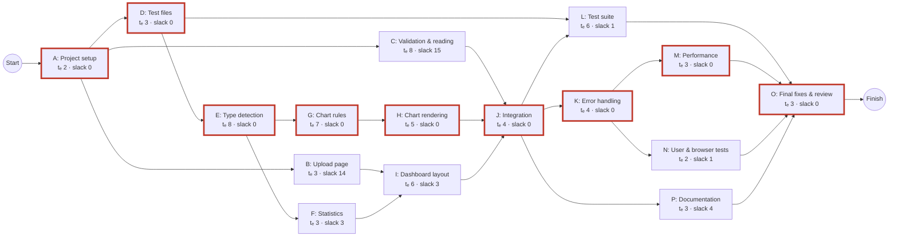
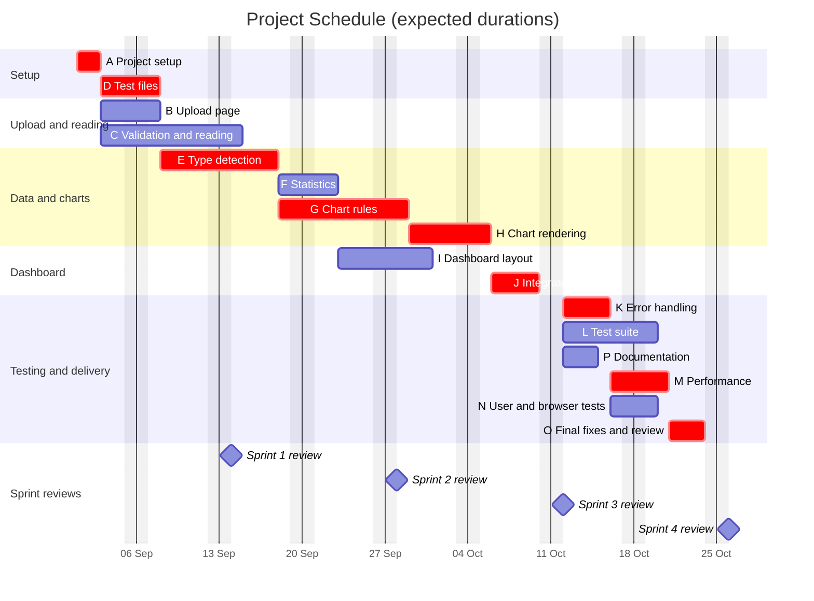

# Project Planning and Estimation

## Automated Data Visualization Dashboard System

| | |
|---|---|
| **Assignment** | 6 – Project Planning and Execution |
| **Based on** | SRS v0.2 (`docs/SRS_DataVisualisation_v0.2.md`) |
| **Team size** | 4 |
| **Schedule start** | Tuesday 1 September 2026 (Sprint 1) |
| **Date** | 10 October 2026 |

> **These figures are planning estimates made before development, not targets.** The code will be written to meet the requirements, however many lines that takes. Actual size, effort and duration will differ, and they will be compared against these estimates after Sprint 4 (Section 6).

---

## Contents

- [1. Scope and Assumptions](#1-scope-and-assumptions)
- [2. Function Point Estimation](#2-function-point-estimation)
- [3. LOC Estimation](#3-loc-estimation)
- [4. COCOMO Estimation](#4-cocomo-estimation)
- [5. Project Scheduling with PERT/CPM](#5-project-scheduling-with-pertcpm)
- [6. Estimated vs. Actual](#6-estimated-vs-actual)

---

## 1. Scope and Assumptions

**Counted:** all requirements planned for Sprints 1–4 in SRS Section 6.1.

**Not counted:** the "Later" items. These are dashboard HTML export (FR-25), column and chart selection (FR-22) and the optional AI feature (FR-27 to FR-29, FR-52). If they are built, the extra size is planned scope growth, not an estimation error.

**Assumptions:**
- The team has 4 members, all working on the project at the same time.
- Schedule durations are in working days, Monday to Friday. Public holidays and exam weeks are not excluded.
- 1 person-month (PM) = 152 hours, the standard COCOMO figure.
- Lines of code (LOC) means non-blank, non-comment source lines.
- Test code is estimated separately and is not included in the COCOMO input (Section 3.4).

---

## 2. Function Point Estimation

### 2.1 Method

Function points (FP) measure size by the functionality the user receives, so they can be counted from the SRS before any code exists. The IFPUG method is used:

1. Identify the five component types:
   - External Inputs (EI)
   - External Outputs (EO)
   - External Inquiries (EQ)
   - Internal Logical Files (ILF)
   - External Interface Files (EIF)
2. Rate each component Low, Average or High, using the IFPUG complexity matrices. These are based on the number of data elements and files referenced.
3. Add up the weights to get the **Unadjusted Function Points (UFP)**.
4. Rate the 14 General System Characteristics (GSC) from 0 to 5. Calculate the **Value Adjustment Factor**: VAF = 0.65 + 0.01 × ΣGSC.
5. **FP = UFP × VAF**

**IFPUG weights:**

| Component | Low | Average | High |
|---|---|---|---|
| External Input (EI) | 3 | 4 | 6 |
| External Output (EO) | 4 | 5 | 7 |
| External Inquiry (EQ) | 3 | 4 | 6 |
| Internal Logical File (ILF) | 7 | 10 | 15 |
| External Interface File (EIF) | 5 | 7 | 10 |

### 2.2 Component Count

**External Inputs** – data or control entering the system from the user.

| ID | Function | Complexity | Weight | Reason | Requirements |
|---|---|---|---|---|---|
| EI-1 | Upload and process a file | High | 6 | References four logical files and carries the most validation logic, including the error messages E-01 to E-07 | FR-01 to FR-05, FR-35 to FR-38 |
| EI-2 | Switch to another sheet | Average | 4 | Re-submits the same file with a sheet name, so it references the same files with fewer data elements | FR-34 |

**External Outputs** – information sent to the user that involves calculation or derived data. Each chart type counts as a separate output because each one has its own selection and aggregation logic.

| ID | Function | Complexity | Weight | Reason | Requirements |
|---|---|---|---|---|---|
| EO-1 | Summary cards | Average | 5 | Derived counts, missing %, date range | FR-06, FR-19 |
| EO-2 | Warnings panel | Average | 5 | Combines column warnings, skipped and sampled charts | FR-17, FR-23, FR-43, FR-53 |
| EO-3 | Column information table | Low | 4 | One file, few data elements | FR-49 |
| EO-4 | Line chart (R1) | Average | 5 | Totals or averages per date, monthly grouping, high/low markers | FR-12, FR-16 |
| EO-5 | Bar chart (R2) | Average | 5 | Totals per category, top-15 limit, largest-bar highlight | FR-12, FR-16, FR-46 |
| EO-6 | Pie chart (R3) | Low | 4 | 2 to 6 categories, few data elements | FR-14 |
| EO-7 | Histogram (R4) | Low | 4 | One numeric column, automatic bins | FR-12 |
| EO-8 | Scatter plot (R5) | Average | 5 | Correlation check, 5,000-point sampling note | FR-45 |
| EO-9 | Correlation heatmap (R6) | Average | 5 | Pairwise correlation of all numeric columns | FR-47 |

**External Inquiries** – data retrieved and shown without calculation.

| ID | Function | Complexity | Weight | Reason | Requirements |
|---|---|---|---|---|---|
| EQ-1 | Data preview (first 10 rows) | Average | 4 | Number of data elements grows with the column count (20+ for wide files) | FR-50 |
| EQ-2 | Sheet list in the selector | Low | 3 | Sheet names only | FR-34 |
| EQ-3 | Download a chart as PNG | Low | 3 | Exports an existing chart, no new data | FR-24 |

**Internal Logical Files** – groups of data the system builds and maintains.

| ID | File | Complexity | Weight | Reason |
|---|---|---|---|---|
| ILF-1 | Cleaned dataset | Low | 7 | One record type |
| ILF-2 | Column profile (type, missing values, statistics) | Low | 7 | Two record types (column info, numeric statistics) |
| ILF-3 | Chart specification list | Low | 7 | One record type (see SRS Section 6.6) |
| ILF-4 | Error log (`logs/app.log`) | Low | 7 | One record type |

**External Interface Files** – data maintained by another application and only read by this system.

| ID | File | Complexity | Weight | Reason |
|---|---|---|---|---|
| EIF-1 | Uploaded spreadsheet | Average | 7 | Maintained in Excel or another tool and never changed by this system (FR-11). Several sheets, many columns |

**Counting notes:**
- Error messages are counted as part of the input that produces them (EI-1), not as separate outputs. This is the IFPUG rule.
- Libraries such as pandas, Plotly and calamine are not External Interface Files. An EIF is a group of *data*, not code.
- The "Analyse another file" button (FR-51) only navigates between pages and moves no data, so it is not counted.
- Statistics (FR-09, FR-39) are not a separate output. They feed the summary cards, charts and column table.
- The system keeps nothing between requests (`docs/decisions.md`), so ILF-1 to ILF-3 exist only while a file is being processed. They are counted because each is a distinct group of data the system builds, holds and reads during processing. A stricter IFPUG reading would count only the error log as an ILF. That would lower UFP by 21, giving FP ≈ 71.

### 2.3 Unadjusted Function Points

| Component | Low | Average | High | UFP |
|---|---|---|---|---|
| EI | 0 × 3 | 1 × 4 | 1 × 6 | 10 |
| EO | 3 × 4 | 6 × 5 | 0 × 7 | 42 |
| EQ | 2 × 3 | 1 × 4 | 0 × 6 | 10 |
| ILF | 4 × 7 | 0 × 10 | 0 × 15 | 28 |
| EIF | 0 × 5 | 1 × 7 | 0 × 10 | 7 |
| **Total** | | | | **97** |

### 2.4 General System Characteristics

| # | Characteristic | Rating (0–5) | Reason |
|---|---|---|---|
| 1 | Data communications | 2 | Browser and server talk over HTTP, local machine only |
| 2 | Distributed data processing | 1 | The server prepares chart data and plotly.js draws the charts in the browser |
| 3 | Performance | 3 | Explicit time limits (NFR-01 to NFR-04) shape the design (fast reader, sampling) |
| 4 | Heavily used configuration | 1 | Runs on an ordinary laptop |
| 5 | Transaction rate | 0 | One user, one file at a time |
| 6 | Online data entry | 5 | All transactions are interactive (IFPUG gives 5 when more than 30% are) |
| 7 | End-user efficiency | 3 | Loading indicator, plain messages, responsive grid, chart download (NFR-13) |
| 8 | Online update | 1 | Logical files are rebuilt for each upload; nothing needs recovery |
| 9 | Complex processing | 4 | Type detection rules, statistics, correlation, chart rules, sampling, per-column failure handling (FR-53) |
| 10 | Reusability | 2 | Chart rules return plain specifications that a future AI feature can reuse (SRS Section 6.6) |
| 11 | Installation ease | 2 | `requirements.txt` and one start command; no installer |
| 12 | Operational ease | 1 | Error log only; no backup or restart procedures needed |
| 13 | Multiple sites | 2 | Must work in Chrome, Edge and Firefox on users' own computers (NFR-17) |
| 14 | Facilitate change | 2 | Thresholds kept in one configuration file (NFR-16) |
| | **Total (ΣGSC)** | **29** | |

### 2.5 Result

- VAF = 0.65 + 0.01 × 29 = **0.94**
- FP = 97 × 0.94 = 91.18 ≈ **91 function points**

---

## 3. LOC Estimation

LOC is estimated in two independent ways and the results are compared.

### 3.1 Bottom-Up: Per Module

Each module in SRS Section 6.6 is given an optimistic (O), most likely (M) and pessimistic (P) size. The expected size is the PERT weighted average:

**Expected LOC = (O + 4M + P) / 6**

| Module | Contents | O | M | P | Expected |
|---|---|---|---|---|---|
| `app.py` | Routes for upload, process and sheet switch; error pages; logging setup | 100 | 180 | 300 | 187 |
| `validator.py` | Type and content checks, size and row limits, password detection, CSV separator and encoding, Excel/CSV reading, sheet choice, heading cleanup | 200 | 350 | 550 | 358 |
| `profiler.py` | Missing-value rules, number and date cleaning, type detection rules, ID detection, statistics, totals rule, warnings | 300 | 500 | 800 | 517 |
| `chart_rules.py` | Rules R1 to R6, priority order, chart limits, top-15, sampling flag, captions | 200 | 350 | 550 | 358 |
| `renderer.py` | Six Plotly chart builders, markers and highlights, sample notes | 150 | 300 | 450 | 300 |
| `config.py` | All thresholds in one place | 30 | 50 | 80 | 52 |
| `templates/` | Base layout, upload page, dashboard page | 150 | 250 | 400 | 258 |
| `static/` | CSS (responsive grid), JavaScript (loading indicator, button state, sheet selector) | 100 | 180 | 300 | 187 |
| **Total** | | **1,230** | **2,160** | **3,430** | **2,217** |

**Bottom-up estimate: about 2,217 LOC (2.2 KLOC).**

### 3.2 Top-Down: From Function Points

LOC = FP × (LOC per FP for the language). The LOC-per-FP figures come from the QSM Function Point Languages Table (v5.0). That table has no Python row. QSM's advice is to substitute a comparable language and allow a wider range. JavaScript, the closest dynamic language listed, is used for the Python and JavaScript code. HTML is used for templates and CSS. The 80/20 split comes from the bottom-up estimate (1,772 of 2,217 lines are Python or JavaScript).

| Part | Share | QSM language used | LOC/FP (average) | LOC/FP (low) |
|---|---|---|---|---|
| Python and JavaScript | 80% | JavaScript | 47 | 31 |
| Templates and CSS | 20% | HTML | 34 | 14 |
| **Blended** | | | **44.4** | **27.6** |

- Average: 91 × 44.4 ≈ **4,040 LOC**
- Low end: 91 × 27.6 ≈ **2,512 LOC**

### 3.3 Comparison

| Method | Estimate |
|---|---|
| Bottom-up (per module) | 2,217 LOC |
| Top-down (FP, low end) | 2,512 LOC |
| Top-down (FP, average) | 4,040 LOC |

The bottom-up figure is about 12% below even the low end of the top-down range. Three reasons are expected:
- Python is usually more concise than JavaScript.
- pandas, Plotly and Flask do much of the heavy work, so fewer lines are needed for the same functionality.
- QSM's averages come from commercial projects, which carry more framework and boilerplate code.

The bottom-up figure is based on this project's actual module design, so **2.2 KLOC is used as the main estimate**. The top-down average (4.0 KLOC) is kept as an upper bound.

### 3.4 Test Code

Under the Definition of Done (SRS Section 6.3), every backlog item needs automated tests. Test code is estimated separately so it does not inflate the product size:

| Item | O | M | P | Expected |
|---|---|---|---|---|
| pytest unit and integration tests | 800 | 1,500 | 2,500 | 1,550 |

---

## 4. COCOMO Estimation

### 4.1 Model and Mode

Basic COCOMO (Boehm, 1981):

- **Effort:** E = a × (KLOC)^b, in person-months
- **Development time:** D = c × (E)^d, in months
- **Average staff:** P = E / D

The project fits the **organic** mode:
- It is a small team.
- The problem is well understood (reading files, summarising data, drawing charts).
- There are few hard constraints.
- There is no new hardware or complex external interface.

| Mode | a | b | c | d |
|---|---|---|---|---|
| **Organic** | **2.4** | **1.05** | **2.5** | **0.38** |
| Semi-detached | 3.0 | 1.12 | 2.5 | 0.35 |
| Embedded | 3.6 | 1.20 | 2.5 | 0.32 |

### 4.2 Calculation

**Main estimate (bottom-up, 2.217 KLOC):**

- E = 2.4 × (2.217)^1.05 = 2.4 × 2.307 = **5.54 person-months**
- D = 2.5 × (5.54)^0.38 = 2.5 × 1.916 = **4.79 months**
- P = 5.54 / 4.79 = **1.16 people**

**Both estimates side by side:**

| | Bottom-up (2.22 KLOC) | Top-down average (4.04 KLOC) |
|---|---|---|
| Effort (E) | 5.5 PM | 10.4 PM |
| Development time (D) | 4.8 months | 6.1 months |
| Average staff (P) | 1.2 people | 1.7 people |
| Productivity (LOC / E) | 400 LOC per PM | 389 LOC per PM |
| Effort in hours (× 152) | 842 hours | 1,580 hours |
| Hours per member (÷ 4) | 210 hours | 395 hours |

### 4.3 Interpretation

- **Effort:** the main estimate is about 840 hours of work, or about 210 hours per member. Spread over the 39-working-day schedule in Section 5 (about 8 weeks), that is roughly 27 hours per member per week.
- **Schedule:** COCOMO's development time (4.8 months) assumes the "natural" team size of about 1 person. This team has 4 people working in parallel streams (Section 5), so the planned calendar time is much shorter, about 1.9 months. That is roughly 40% of the COCOMO nominal schedule, which by COCOMO's standards is a strongly compressed plan.
- **Limits of the model:** Basic COCOMO was calibrated on projects from the 1960s and 70s that used older languages and tools. It has no inputs for modern libraries, IDEs or team ability. Intermediate COCOMO adds these as cost drivers. So the model may overestimate effort for this project, but the actual figures in Section 6 will show whether it did.
- **Action:** each member records the hours they spend each week, so actual effort can be compared with the 5.5 PM estimate.

---

## 5. Project Scheduling with PERT/CPM

### 5.1 Activities and Time Estimates

Each activity has an optimistic (o), most likely (m) and pessimistic (p) duration in working days. From these:

- **Expected time:** tₑ = (o + 4m + p) / 6
- **Variance:** σ² = ((p − o) / 6)²

| ID | Activity | Requirements | Predecessors | o | m | p | tₑ | σ² | Sprint |
|---|---|---|---|---|---|---|---|---|---|
| A | Project setup (Flask skeleton, config, pytest, local plotly.js) | NFR-11, NFR-16 | – | 1 | 2 | 3 | 2 | 0.11 | 1 |
| B | Upload page and routes | FR-01, NFR-04, NFR-08, NFR-09 | A | 1 | 3 | 5 | 3 | 0.44 | 1 |
| C | File validation and reading | FR-02 to FR-05, FR-11, FR-34 (default sheet), FR-35, FR-36, FR-38, NFR-07 | A | 5 | 7 | 15 | 8 | 2.78 | 1 |
| D | Prepare test file set TF-01 to TF-16 | SRS 6.4 | A | 2 | 3 | 4 | 3 | 0.11 | 1 |
| E | Data cleaning and column type detection | FR-07, FR-08, FR-40 to FR-43 | D | 6 | 7 | 14 | 8 | 1.78 | 1–2 |
| F | Statistics and meaningful totals | FR-06, FR-09, FR-10, FR-39 | E | 2 | 3 | 4 | 3 | 0.11 | 2 |
| G | Chart selection rules R1 to R6 | FR-12 to FR-14, FR-17, FR-44 to FR-48 | E | 4 | 7 | 10 | 7 | 1.00 | 2 |
| H | Chart rendering with Plotly | FR-15, FR-16, FR-24 | G | 3 | 5 | 7 | 5 | 0.44 | 3 |
| I | Dashboard layout and templates | FR-18 to FR-21, FR-23, FR-49, FR-50, NFR-10 | B, F | 3 | 6 | 9 | 6 | 1.00 | 2–3 |
| J | Integration and sheet selector | FR-34 (selector), FR-51 | C, H, I | 2 | 4 | 6 | 4 | 0.44 | 3 |
| K | Error handling and logging | FR-30 to FR-33, FR-37, FR-53 | J | 2 | 4 | 6 | 4 | 0.44 | 4 |
| L | Complete automated test suite | SRS 6.4, NFR-18 | D, J | 4 | 6 | 8 | 6 | 0.44 | 4 |
| M | Performance testing and tuning | NFR-01 to NFR-03 | K | 2 | 2 | 8 | 3 | 1.00 | 4 |
| N | Browser and sample-user testing | NFR-13, NFR-17 | K | 1 | 2 | 3 | 2 | 0.11 | 4 |
| P | User documentation and README | SRS 2.6 | J | 2 | 3 | 4 | 3 | 0.11 | 4 |
| O | Final fixes and Sprint 4 review | SRS 6.3 | L, M, N, P | 1 | 3 | 5 | 3 | 0.44 | 4 |

**Dependency notes:**
- Column type detection (E) needs the test files (D) but not the finished validator (C). Profiling can be developed on DataFrames loaded directly with pandas. This lets the validator and the profiler be built in parallel by different members.
- Rendering (H) starts after the chart rules (G), because it draws the specifications that G produces.
- Integration (J) is where the validator, the charts and the dashboard first come together.

### 5.2 Network Diagram

Activity-on-node network. Critical activities have a thick red border.

### 5.3 Forward and Backward Pass

- **Forward pass:** ES (earliest start) = the largest EF of all predecessors. EF = ES + tₑ.
- **Backward pass:** LF (latest finish) = the smallest LS of all successors. LS = LF − tₑ.
- **Slack** = LS − ES.

Times are working days from the start of the project. Dates are the expected calendar dates, skipping weekends.

| ID | tₑ | ES | EF | LS | LF | Slack | Critical | Expected dates |
|---|---|---|---|---|---|---|---|---|
| A | 2 | 0 | 2 | 0 | 2 | 0 | Yes | 1 Sep – 2 Sep |
| B | 3 | 2 | 5 | 16 | 19 | 14 | | 3 Sep – 7 Sep |
| C | 8 | 2 | 10 | 17 | 25 | 15 | | 3 Sep – 14 Sep |
| D | 3 | 2 | 5 | 2 | 5 | 0 | Yes | 3 Sep – 7 Sep |
| E | 8 | 5 | 13 | 5 | 13 | 0 | Yes | 8 Sep – 17 Sep |
| F | 3 | 13 | 16 | 16 | 19 | 3 | | 18 Sep – 22 Sep |
| G | 7 | 13 | 20 | 13 | 20 | 0 | Yes | 18 Sep – 28 Sep |
| H | 5 | 20 | 25 | 20 | 25 | 0 | Yes | 29 Sep – 5 Oct |
| I | 6 | 16 | 22 | 19 | 25 | 3 | | 23 Sep – 30 Sep |
| J | 4 | 25 | 29 | 25 | 29 | 0 | Yes | 6 Oct – 9 Oct |
| K | 4 | 29 | 33 | 29 | 33 | 0 | Yes | 12 Oct – 15 Oct |
| L | 6 | 29 | 35 | 30 | 36 | 1 | | 12 Oct – 19 Oct |
| M | 3 | 33 | 36 | 33 | 36 | 0 | Yes | 16 Oct – 20 Oct |
| N | 2 | 33 | 35 | 34 | 36 | 1 | | 16 Oct – 19 Oct |
| P | 3 | 29 | 32 | 33 | 36 | 4 | | 12 Oct – 14 Oct |
| O | 3 | 36 | 39 | 36 | 39 | 0 | Yes | 21 Oct – 23 Oct |

### 5.4 Critical Path

**A → D → E → G → H → J → K → M → O**

Expected project duration = 2 + 3 + 8 + 7 + 5 + 4 + 4 + 3 + 3 = **39 working days**. The expected finish is **Friday 23 October 2026**.

What this means for the team:
- **Test files (D) are on the critical path.** Type detection cannot be checked without them, so they should be prepared in the first week, not left until the testing sprint.
- **The data → chart rules → rendering chain (E, G, H) is the longest run of work.** Any delay in type detection or chart rules delays the whole project.
- **The validator (C) and the upload page (B) have about 3 weeks of slack.** The member working on them can help on the critical path if needed.

### 5.5 Probability of Finishing on Time

The variance of the project is the sum of the variances of the critical activities:

- σ² = 0.11 + 0.11 + 1.78 + 1.00 + 0.44 + 0.44 + 0.44 + 1.00 + 0.44 = **5.78**
- σ = √5.78 = **2.40 working days**

For a deadline T: Z = (T − 39) / 2.40. The probability of finishing by T is read from the standard normal table.

| Deadline (working days) | Date | Z | Probability |
|---|---|---|---|
| 39 (expected) | Fri 23 Oct | 0.00 | 50% |
| 40 (end of Sprint 4) | Mon 26 Oct | 0.42 | 66% |
| 42 | Wed 28 Oct | 1.25 | 89% |
| 45 (one extra week) | Mon 2 Nov | 2.50 | 99% |

The four planned sprints have about a two-in-three chance of being enough. Keeping one buffer week before the final submission raises this to about 99%.

### 5.6 Gantt Chart

Critical activities are shown in red. Diamonds mark the end of each sprint.

---

## 6. Estimated vs. Actual

To be filled in after Sprint 4. Large differences are expected and will be explained, not hidden.

| Measure | Estimate | Actual | Difference | Reason for difference |
|---|---|---|---|---|
| Function points | 91 | | | |
| Production LOC | 2,217 (upper bound 4,040) | | | |
| Test LOC | 1,550 | | | |
| Effort | 5.5 PM (842 hours) | | | |
| Duration | 39 working days (finish 23 Oct) | | | |
| Critical path | A → D → E → G → H → J → K → M → O | | | |

**How the actual figures will be measured:**
- **Function points:** recount Section 2 against the finished system.
- **LOC:** count with a tool such as `cloc` or `pygount`, excluding blank and comment lines. Count `tests/` separately.
- **Effort:** use the hours each member records weekly.
- **Duration and critical path:** compare actual task start and finish dates with Section 5.3.
