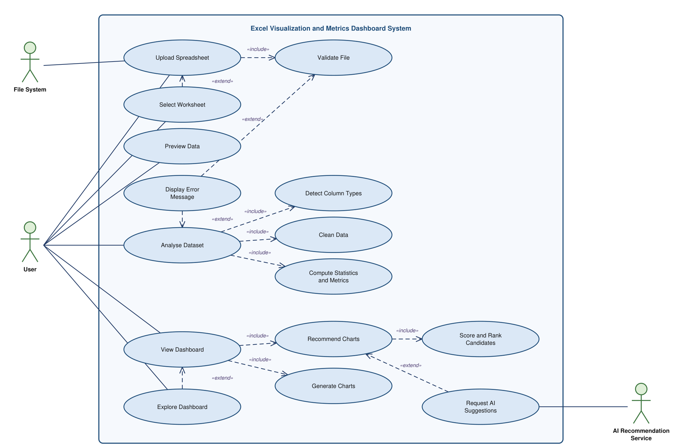
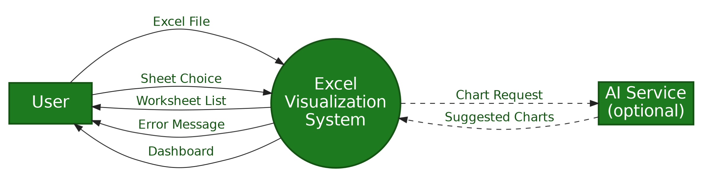
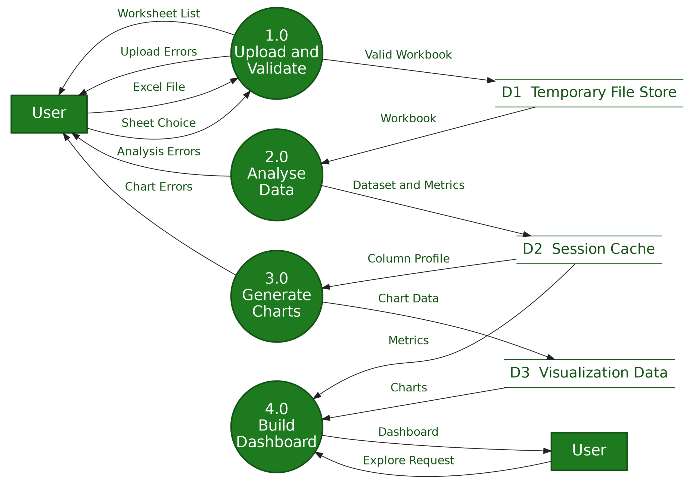
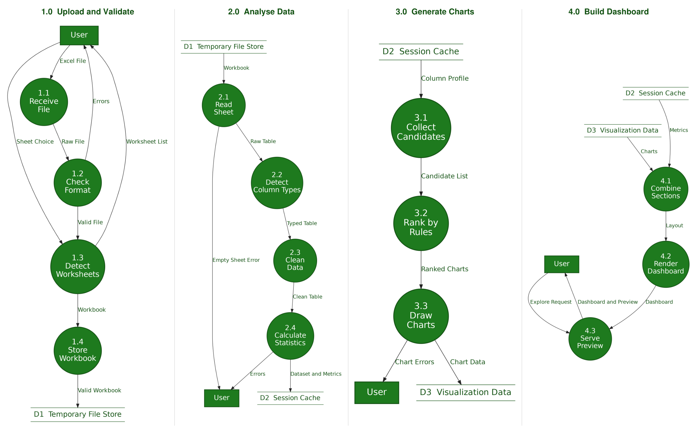
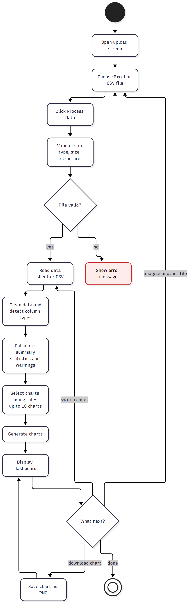
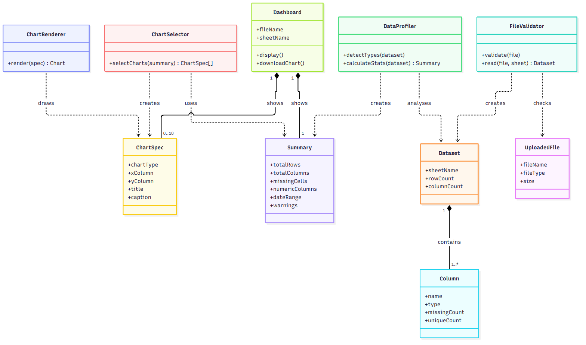
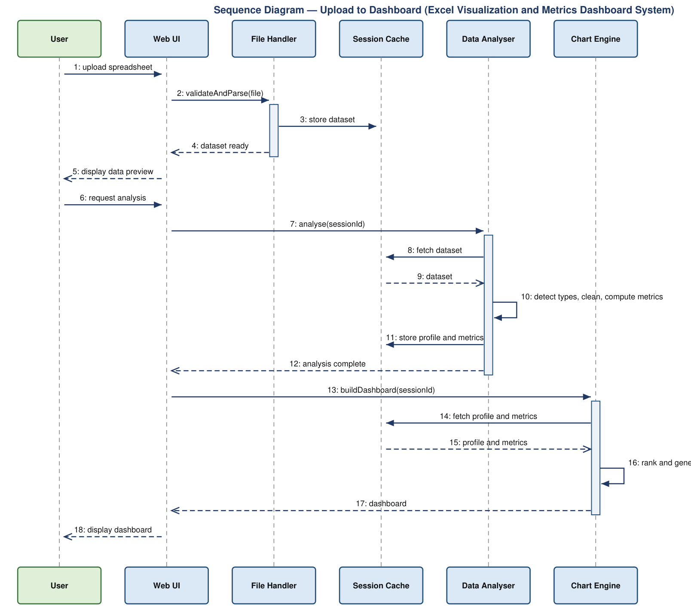
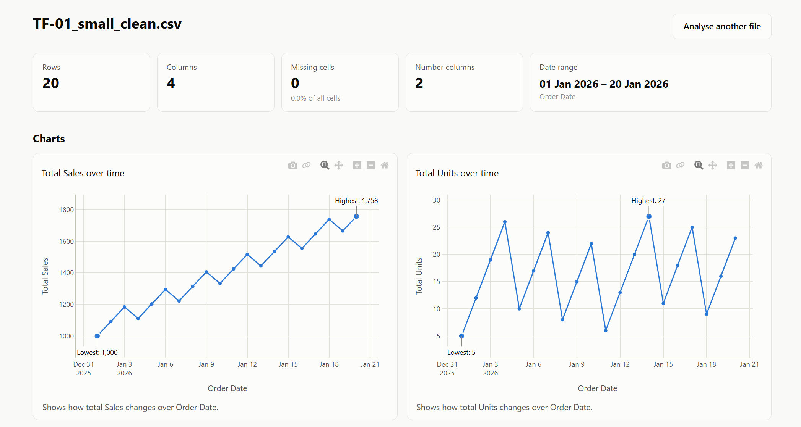
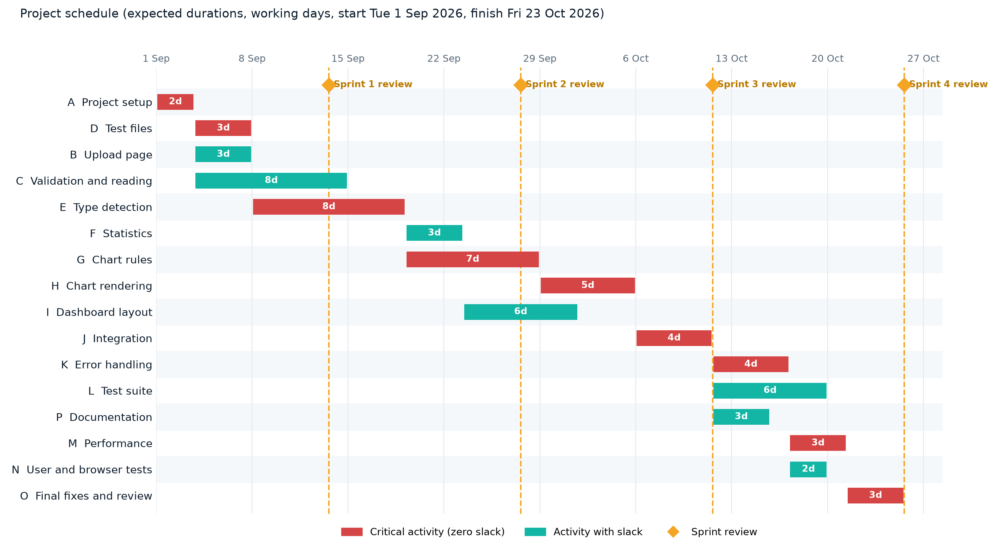

# Project Report

## Automated Data Visualization Dashboard System

| | |
|---|---|
| **Report date** | 23 October 2026 |
| **Project type** | Semester project, software engineering (Agile) |
| **Team size** | 4 |
| **Requirements baseline** | SRS v0.3 (`docs/SRS_DataVisualisation_v0.3.md`) |
| **Code state** | Working application, 177 automated tests and 6 browser tests passing |

---

## Abstract

Many people have large Excel or CSV files but do not know which calculations or charts suit their data. Building each graph by hand is slow and easy to get wrong.

This project is a web application that removes that work. The user uploads a spreadsheet (`.xlsx`, `.xls` or `.csv`, up to 25 MB). The system checks the file, cleans common formatting problems, detects the type of every column (number, date, category, ID, text), calculates summary values, and picks up to 10 suitable charts using a fixed, documented set of rules. Everything is shown on one dashboard: summary cards, warnings, charts, a column information table and a data preview. Any chart can be saved as a PNG image.

The system runs locally in the browser, works without an internet connection, never changes the uploaded file, and does not depend on AI. Chart choices are made by six explicit rules (R1 to R6), so every chart on the dashboard can be explained.

The application is written in Python with Flask, pandas and Plotly. It is about 1,744 lines of code (non-blank) and is checked by 177 automated tests and 6 Selenium browser tests, all passing. A file of 50,000 rows by 30 columns is processed in about 4 seconds against a requirement of 30 seconds. The project was planned with function points, COCOMO and PERT/CPM, and this report includes the plan, including the Gantt chart.

---

## Contents

1. [Introduction](#1-introduction)
2. [Existing approaches and the gap](#2-existing-approaches-and-the-gap)
3. [Development process](#3-development-process)
4. [Requirements](#4-requirements)
5. [System analysis and design](#5-system-analysis-and-design)
6. [Implementation](#6-implementation)
7. [Project planning and estimation](#7-project-planning-and-estimation)
8. [Testing](#8-testing)
9. [Results](#9-results)
10. [Limitations and risks](#10-limitations-and-risks)
11. [Future work](#11-future-work)
12. [Conclusion](#12-conclusion)
13. [References](#13-references)
- [Appendix A: Error message catalogue](#appendix-a-error-message-catalogue)
- [Appendix B: Requirement coverage](#appendix-b-requirement-coverage)
- [Appendix C: Project files](#appendix-c-project-files)
- [Appendix D: Running the project](#appendix-d-running-the-project)

---

## 1. Introduction

### 1.1 Background and problem

A spreadsheet holds answers, but turning rows into understanding needs two skills: knowing which summary values matter, and knowing which chart suits which kind of column. A student with an attendance sheet, a teacher with marks, or an office user with monthly sales usually has the data but not the time, or the chart-choosing skill, to explore it.

### 1.2 Objectives

1. **Accept real-world files.** Upload `.xlsx`, `.xls` and `.csv` files up to 25 MB, check them, and explain any problem in plain language.
2. **Understand the data automatically.** Detect column types, clean formatting (currency symbols, thousand separators, mixed date formats), and calculate count, total, average, median, minimum, maximum, standard deviation and missing values.
3. **Show the right charts.** Choose up to 10 suitable charts using fixed, explainable rules and show them with the summary on one dashboard.
4. **Stay simple, safe and local.** No account, no database, no outside service. The original file is never modified, and text from the file can never run as code in the browser.

### 1.3 Scope

| In scope (first release) | Out of scope (first release) |
|---|---|
| Uploading and validating `.xlsx`, `.xls` and `.csv` files | User accounts and login |
| Column type detection and summary statistics | Saving past reports, or a database |
| Rule-based selection of multiple charts | Editing data inside the app |
| A single-page dashboard | Online hosting |
| PNG export of charts | PDF export, AI recommendations |

Backlog items for later: choosing a column or chart (FR-22), downloading the dashboard as an HTML file (FR-25), and an optional AI recommendation feature (FR-27 to FR-29, FR-52).

### 1.4 Users

| User | Description | Main needs |
|---|---|---|
| General user | Student, teacher, analyst or office user with basic computer knowledge | Upload a file and understand the results without training |
| Developer / admin | Builds and maintains the system | Test, read error logs, fix errors, update chart rules |
| Project guide / tester | Checks whether the project meets its requirements | Review features and test outputs at sprint reviews |

### 1.5 Organisation of this report

Sections 2 to 4 explain the problem, the way the work was organised and the requirements. Section 5 gives the design with the UML and data flow diagrams. Section 6 explains how it was built. Section 7 holds the plan, estimates and Gantt chart. Section 8 covers testing, and sections 9 to 12 give the results, limits, future work and conclusion.

---

## 2. Existing approaches and the gap

Common ways to chart a spreadsheet today:

- **Manual charts in a spreadsheet program.** Flexible, but the user must choose the columns, the chart type and the formatting for every chart.
- **Business intelligence tools.** Powerful, but they need installation or an account, and a learning period before the first dashboard.
- **Recommended-chart features in spreadsheet programs.** Quick for one chart, but they do not describe the whole dataset or explain their choices.

The gap this project fills is a small, local tool that goes from a raw file to a whole-dataset dashboard in one step, without configuration, and that **explains why each chart was chosen**. Every chart carries a one-line caption such as "Compares total Sales across 5 Region values." The rules are written down (SRS 4.3.2), so results are predictable and testable.

---

## 3. Development process

### 3.1 Agile plan

The SRS follows the Agile model: requirements may change after each sprint review, and requirement IDs are never renumbered or reused. The work is planned over four sprints of about two weeks.

| Sprint | Goal | Main requirements |
|---|---|---|
| 1 | Upload, validation and reading files | FR-01 to FR-05, FR-11, FR-34 (default sheet), FR-35, FR-36, FR-38, FR-56, NFR-08, NFR-09 |
| 2 | Column detection, statistics and chart rules (tested without the UI) | FR-06 to FR-10, FR-12 to FR-17, FR-39 to FR-48, FR-54, FR-55 |
| 3 | Dashboard design and multiple charts | FR-18 to FR-21, FR-23, FR-24, FR-34 (selector), FR-49 to FR-51, NFR-10 |
| 4 | Error handling, testing and improvements | FR-30 to FR-33, FR-37, FR-53, NFR-01 to NFR-04, NFR-13 to NFR-18 |
| Later | HTML export, column selection, optional AI | FR-22, FR-25, FR-27 to FR-29, FR-52 |

### 3.2 Definition of Done

A backlog item is Done when:

1. The code is written and merged into the main project.
2. The related acceptance criteria pass.
3. Automated tests for the item are written and all tests pass.
4. It has been checked manually with at least one file from the test set.
5. It has been shown at a sprint review.
6. Its status in the SRS is updated.

### 3.3 How the work actually went

- **Planning first.** Estimation (function points, COCOMO, PERT/CPM, Gantt chart), activity diagrams and an analysis class diagram were done before building (Section 7 and Section 5). The design class diagram is meant to be regenerated from the real code afterwards.
- **One pass, then phases.** The code for sprints 1 to 4 was written in a single pass, before the phase-by-phase way of working was agreed. Since then, work goes one phase at a time, each ending with a list of changed files, test results and a review.
- **Phase 1 (15 October 2026).** Decisions were recorded and SRS v0.3 was written. It added the repeating-ID rule (FR-54), the row-count line chart (FR-55), the title-row rule (FR-56) and removed the 20-value cap on categories. The test count rose from 142 to 177.
- **Records.** The SRS, the decisions log (`docs/decisions.md`), the progress report and the planning document are kept in `docs/`.

---

## 4. Requirements

The full requirements are in SRS v0.3. This section summarises them. Requirement IDs (`FR`, `NFR`, `BR`, `US`, `E`, `TF`) match the SRS.

### 4.1 Functional requirements by area

| Area | What the system shall do | Key IDs |
|---|---|---|
| File upload and validation | Accept `.xlsx`, `.xls`, `.csv`; check the extension **and** the content; reject files over 25 MB before loading; reject files over 1,000,000 rows; detect password-protected files; pick the first usable sheet and let the user switch sheets; detect CSV separator and encoding; clean headings; skip a title row above the headings | FR-01 to FR-05, FR-34 to FR-38, FR-56 |
| Data processing | Count rows and columns; count missing values (blank, spaces, NA, N/A, null, none, "-"); classify each column; convert numbers stored as text; read Excel and text dates (day-first); exclude ID columns from statistics and charts; calculate count, average, median, minimum, maximum, standard deviation and totals only when meaningful | FR-06 to FR-11, FR-39 to FR-43, FR-54 |
| Chart selection | Apply rules R1 to R6; make more than one chart; never use a pie for more than 6 categories; label charts with titles, axes, units and a caption; show at most 10 charts; sample large scatter plots; show top 15 for large bar charts; skip unsuitable charts and list them | FR-12 to FR-17, FR-44 to FR-48, FR-55 |
| Dashboard | File and sheet name; summary cards; warnings panel; chart grid (two per row at 1200 px or wider); column information table; data preview of 10 rows; "Analyse another file" | FR-18 to FR-23, FR-49 to FR-51 |
| Export | Save any chart as PNG | FR-24 |
| Error handling | Plain messages for every problem; technical errors logged, never shown; one failing column or chart does not stop the rest | FR-30 to FR-33, FR-53 |
| Later | Choose column or chart, HTML download, optional AI | FR-22, FR-25, FR-27 to FR-29, FR-52 |

### 4.2 Nonfunctional requirements

| Quality | Requirement |
|---|---|
| Performance | 50,000 rows × 30 columns in 30 s or less (target 10 s) (NFR-01); a 25 MB file in 60 s or less (NFR-02); dashboard displayed within 5 s (NFR-03); loading indicator within 1 s of clicking (NFR-04) |
| Safety | The original file is never edited, moved or deleted (NFR-05) |
| Security | No data sent to outside services (NFR-06); files processed in memory (NFR-07); file names cleaned (NFR-08); size limit enforced by the server (NFR-09); all text from the file HTML-escaped (NFR-10); server listens on 127.0.0.1 only (NFR-11); hosting later needs access control and HTTPS (NFR-12) |
| Ease of use | A new user can upload a file and view the dashboard unaided in under 2 minutes (NFR-13) |
| Correctness | Summary values match manual calculation (NFR-14) |
| Reliability | A problem in one column does not stop other results (NFR-15) |
| Maintainability | Separate modules; thresholds in one configuration file (NFR-16) |
| Compatibility | Current Chrome, Edge and Firefox (NFR-17) |
| Testability | Core functions testable without the web server; test suite under 60 s (NFR-18) |

**Business rules:** only `.xlsx`, `.xls` and `.csv` are processed (BR-01); the original file stays unchanged (BR-02); no pie chart above 6 categories (BR-03); readable charts over decorative ones, so no 3D (BR-04); the optional AI feature never blocks or replaces the rules (BR-05); ID columns are never totalled, averaged or charted (BR-06).

### 4.3 User stories

| ID | Story | Acceptance in short |
|---|---|---|
| US-01 | Upload a file and see charts without making them | Valid file under 25 MB gives a dashboard; a `.pdf` gives E-01 |
| US-02 | Clear messages when the file has a problem | Matching message, no technical text, can retry without restarting |
| US-03 | Summary cards for size and quality at a glance | Rows, columns, missing cells and numeric columns match the file |
| US-04 | The system picks sensible charts | Date and number give a line chart; 4 categories give a bar (and possibly a pie); 12 categories give no pie; at most 10 charts; IDs never charted |
| US-05 | Choose a sheet in a multi-sheet workbook | First sheet with data by default; selector refreshes the dashboard |
| US-06 | Save a chart as an image | PNG shows the full chart with its title |
| US-07 | Warnings and a preview to trust the data | Columns over 20% missing are listed; first 10 rows match the file |
| US-08 | Technical errors logged (developer) | Unexpected error adds time, file name and details to `logs/app.log` |

---

## 5. System analysis and design

### 5.1 Architecture and module structure

The system is a small web application. The browser sends a file to a Flask route. The route runs four processing modules in sequence, and a template shows the result. The processing modules are separate so that each can be tested alone (NFR-16, NFR-18).

```
Browser (static/app.js)
      │  POST /process
      ▼
app.py            Flask routes, error pages, logging
  ├─ validator.py     file checks, reading CSV or Excel          → RawTable
  ├─ profiler.py      cleaning, column types, statistics         → DatasetProfile
  ├─ chart_rules.py   chooses which charts to make (plain data)  → chart specifications
  └─ renderer.py      builds Plotly figures                      → JSON for the page
templates/dashboard.html  →  Browser draws charts with the local plotly.js
config.py         all thresholds in one place
```

`chart_rules.py` returns plain data, not drawings. For example:

```json
{"type": "line", "rule": "R1", "x": "Order Date", "y": "Sales", "agg": "sum",
 "title": "Total Sales over time", "caption": "Shows how total Sales changes over Order Date."}
```

This lets the rules be tested without drawing anything, and lets a future AI feature add specifications without changing the rest.

**Data passed between modules**

| From → To | Object | What it holds |
|---|---|---|
| `validator` → `profiler` | `RawTable` | File name and kind, sheet name and all sheet names, CSV encoding and separator, the data rows as original cell values (headings cleaned), number of empty rows and columns ignored |
| `profiler` → `chart_rules` | `DatasetProfile` | Row and column counts, missing-cell totals, one `ColumnProfile` per column, cleaned values of chartable columns, correlation matrix, preview rows, warnings |
| `chart_rules` → `renderer` | list of `dict` | One plain-data specification per chart |
| `renderer` → template | list of `RenderedChart` | Chart id, type, title, caption, note, Plotly figure as script-safe JSON, PNG download name |

**Statelessness.** The server stores nothing between requests. For sheet switching, `app.js` keeps the chosen `File` in browser memory and posts it again with the new sheet name.

### 5.2 Use case diagram

The user is the primary actor. The file system and the optional AI recommendation service are secondary actors. Dashed arrows show `«include»` (mandatory reuse, such as upload including validation) and `«extend»` (conditional behaviour, such as displaying an error message).



### 5.3 Data flow diagrams

**Level 0** shows the whole system as one process with two external entities: the user and the optional AI service.



**Level 1** splits the system into four processes (1.0 Upload and Validate, 2.0 Analyse Data, 3.0 Generate Charts, 4.0 Build Dashboard) and three data stores: D1 Temporary File Store (the uploaded workbook during processing), D2 Session Cache (the analysed dataset) and D3 Visualization Data (chart data). D1 and D2 are cleared when the session ends.



**Level 2** breaks each process into sub-processes. Column types are detected before cleaning because both cleaning and statistics depend on them, and chart candidates are ranked by fixed rules so that every chart shown can be explained.



### 5.4 Activity diagram

The simplified activity diagram shows the whole flow: choose a file, validate it, read, clean and detect types, calculate statistics, select up to 10 charts, generate them and show the dashboard. From the dashboard the user can switch sheet, save a chart as PNG, analyse another file, or finish. An invalid file shows an error and returns to the upload screen.



Seven detailed activity diagrams (upload to dashboard, validate and read a file, profile the data, detect a column type, select charts, render charts, switch sheet) are in `docs/Activity_and_Class_Diagrams.md`, with images in `docs/diagrams/` (`AD-1` to `AD-7`).

### 5.5 Class diagram

`FileValidator` checks an `UploadedFile` and creates a `Dataset`, which contains one or more `Column` objects. `DataProfiler` analyses the dataset and creates a `Summary`. `ChartSelector` uses the summary and creates up to 10 `ChartSpec` objects. `ChartRenderer` draws each specification, and the `Dashboard` shows the summary and the charts.



Two detailed analysis class diagrams (entity classes, and boundary and control classes) are in `docs/Activity_and_Class_Diagrams.md` (`CD-1`, `CD-2`).

### 5.6 Sequence diagram

The main success scenario, in 18 messages across six participants:

- **Steps 1 to 5:** the user uploads a spreadsheet; the web UI asks the file handler to validate and parse it; the dataset is stored; a data preview is shown.
- **Steps 6 to 12:** the user requests analysis; the data analyser fetches the dataset, detects types, cleans the data, computes metrics and stores the profile.
- **Steps 13 to 18:** the chart engine fetches the profile, ranks and generates charts, and the dashboard is displayed.



The design shows a session cache. In the built version the data is held within a single request instead, because the server stores nothing between requests (SRS 6.5).

### 5.7 User interface design

**Upload screen:** project name and one-line description; a file picker for `.xlsx`, `.xls` and `.csv` with the note "Maximum 25 MB. The first row must contain column headings."; a **Process Data** button that stays disabled until a file is chosen; a loading indicator; an area for plain-language errors; and a privacy line saying the file is analysed on this computer and never changed.

**Dashboard screen, top to bottom:**

1. Header with the file name, sheet name or sheet selector, and an **Analyse another file** button.
2. Summary cards: rows, columns, missing cells (count and %), number columns and date range.
3. A "Things to check" warnings panel, hidden when there are no warnings.
4. Chart grid with up to 10 charts, two per row at 1200 px or wider and one per row below. Each chart has a title, axis labels and a caption.
5. Column information table: name, type, missing, unique values and statistics.
6. Data preview of the first 10 rows.



---

## 6. Implementation

### 6.1 Technology

| Component | Choice | Purpose |
|---|---|---|
| Language | Python 3.13 (SRS minimum 3.10) | All processing logic |
| Web framework | Flask, Jinja2 templates | Upload handling, routes, HTML with automatic escaping |
| Local server | Waitress | Serves the app on 127.0.0.1 only |
| Data processing | pandas | Reading and analysing data |
| `.xlsx` reading | python-calamine, with openpyxl as fallback | Calamine is much faster on large files |
| `.xls` reading | xlrd | Legacy Excel files |
| Charts | Plotly (plotly.js served locally from the installed package) | Interactive charts with built-in PNG download, offline |
| Front end | HTML, CSS, a small JavaScript file | Layout, loader, sheet switching |
| Testing | pytest, Selenium | Unit, integration and browser tests |

All tools are free and open source (SRS 2.5).

### 6.2 Modules

**`config.py` (79 lines).** Every threshold and fixed setting is in this one file: the 25 MB limit, 1,000,000 row limit, missing-value words, accepted date formats, detection ratios, chart limits and all user messages. Changing a rule means changing one value here (NFR-16).

**`validator.py` (243 lines).** Turns uploaded bytes into a `RawTable`, entirely in memory (so the original file cannot change). Checks run in this order: extension; size; empty file; content check (a `.csv` that is really a PDF, zip or image is rejected; a password-protected Excel file is detected; a Word file renamed `.xlsx` is rejected; a truncated zip is reported as damaged); then reading.

- *CSV:* tries UTF-8 with BOM, UTF-8, then Windows-1252; detects the separator (comma, semicolon, tab, pipe); reads every cell as text so missing values and headings follow the project's own rules, not pandas' defaults.
- *Excel:* opens `.xlsx` with calamine (openpyxl as fallback) and `.xls` with xlrd; reads the chosen sheet, otherwise the first sheet with a heading row and one data row.
- *Table building:* finds the heading row, skips a title row, drops completely empty rows and columns (and counts them), rejects files with no data (E-03) or over 1,000,000 rows (E-06), and cleans headings (trim spaces, blank headings become `Column N`, duplicates get `_2`, `_3`).

**`profiler.py` (308 lines).** Works on a copy of the values and produces a `DatasetProfile`. Each column is analysed inside its own `try` block, so a failure in one column is logged, the column is shown as "Not analysed", and the rest continue (FR-53). It detects types (Section 6.3), cleans numbers and dates, calculates statistics and correlations, builds the preview from the original values and raises warnings.

**`chart_rules.py` (212 lines).** Applies rules R1 to R6 and returns plain specifications (Section 6.4). Each rule is wrapped so that one failing rule does not stop the others.

**`renderer.py` (232 lines).** Turns each specification into a Plotly figure inside its own `try`. A chart with nothing to draw is skipped with a warning; any other failure is logged and reported. Line charts mark the highest and lowest points, bar charts highlight the largest bar, and large scatter plots draw a fixed-seed 5,000-point sample so that the same file always gives the same picture. All spreadsheet text placed in a chart is escaped, and the figure JSON has `<`, `>` and `&` escaped so it can never close the script tag it sits in.

**`app.py` (111 lines).** Flask routes: `GET /` (upload page), `POST /process` (validator → profiler → chart rules → renderer), `GET /vendor/plotly.min.js` (the local plotly.js, cached for a week) and a 413 handler. A custom request class keeps uploads in memory (NFR-07). The server limit `MAX_CONTENT_LENGTH` refuses oversized requests before they are read (NFR-09). File names are cleaned with `secure_filename`. Errors that users can fix show their message; any other exception is logged with a full traceback and the user sees E-09 only. Logging goes to `logs/app.log`, rotating at 1 MB.

**`templates/` (200 lines) and `static/` (359 lines).** Three templates (`base.html`, `upload.html`, `dashboard.html`), one JavaScript file and one stylesheet. `app.js` keeps the button disabled until a file is chosen, checks for a missing or oversized file before uploading, shows the loader at the moment of clicking, posts the file with `fetch`, swaps the response into the page, and draws each chart; if one chart fails in the browser only that chart shows an error. The stylesheet gives two charts per row at 1200 px and above and one below, and puts wide tables inside their own scroll box so the page never scrolls sideways.

### 6.3 Column type detection

Rules apply to non-missing values, in order. The first match decides the type.

| Order | Type | Rule |
|---|---|---|
| 1 | Empty | More than 95% of values are missing |
| 2 | Date | At least 90% are Excel date cells or text readable as a date (21 formats, day-first) |
| 3a | ID (unique) | At least 20 rows, all values unique, and an ID heading or consecutive whole numbers |
| 3b | ID (repeating) | An ID heading and every value a whole number (values may repeat) |
| 4 | Numeric | At least 90% can be read as numbers after cleaning |
| 5 | Category | Unique values are fewer than 50% of rows; a column with exactly two values is always a category |
| 6 | Text | Anything else, counted but not charted |

An **ID heading** is judged by splitting the heading into words (`WORK_ITEM_ID` gives work, item, id; `RollNo` gives roll, no). It counts as an ID heading when the last word is one of `id, no, number, code, roll, key, seq`, or the first word is `id`. So "Roll No" is an ID, but "Number of items" is numeric.

**Number cleaning (FR-40).** Currency symbols (₹ $ € £), thousand separators, % signs and spaces are removed before reading a number. If most text values carried a symbol, it becomes the column's unit and appears in axis labels.

**Meaningful totals (SRS 4.2.4).** A total is shown unless the column is a year (whole numbers from 1900 to 2100 under a heading containing "year"), a percentage, or has a name word such as rate, ratio, average, mean or age. ID columns never get a total.

### 6.4 Chart selection

| Rule | Chart | Used when |
|---|---|---|
| R1 | Line | A date column exists. Values are totalled (or averaged) per date; grouped by month above 100 distinct days. With no number column, rows per date are counted |
| R2 | Bar | A category column exists. Sorted largest first; top 15 with a note above 15 categories |
| R3 | Pie | A category column has 2 to 6 values; otherwise a bar is used |
| R4 | Histogram | A numeric column has at least 10 unique values. Bins are the larger of the Sturges and Freedman–Diaconis counts, at most 60 |
| R5 | Scatter | Two numeric columns have a correlation of at least 0.5 (positive or negative); at most 2 pairs; sampled above 5,000 points |
| R6 | Correlation heatmap | Three or more numeric columns |

**Priority and limit.** Candidates are generated in the order R1, R2, R5, R4, R3, R6. The first 10 are shown, with at most 3 of any one chart type. When several columns qualify, those with the fewest missing values are used first. Charts that are left out or skipped are listed in the warnings panel. This ordering means that files with many columns rarely show pie charts or heatmaps; this is recorded as an open item in the SRS.

### 6.5 Security

- **No code from data.** All text from the spreadsheet is HTML-escaped by Jinja2 and by the chart code (NFR-10). Test file TF-15 puts `<script>alert(1)</script>` in a cell; it is shown as text.
- **Content, not just extension.** A PDF renamed `.csv` is rejected (FR-02).
- **Size limit on the server.** Oversized requests are refused before they are read (NFR-09).
- **In-memory processing.** No temporary files are written for uploads (NFR-07). The original file is never changed (NFR-05).
- **Local only.** The server listens on 127.0.0.1 and plotly.js is served locally, so no data leaves the computer and the app works offline (NFR-06, NFR-11).

### 6.6 Error handling and logging

Problems the user can fix get a plain message from the catalogue (Appendix A) and the upload form stays available for another try. Unexpected errors show only E-09; the time, file name and full traceback go to `logs/app.log`. Failures are isolated at four levels: one column, one chart rule, one chart drawing and one chart in the browser. Each failure becomes a line in the warnings panel while the rest of the dashboard is still shown.

### 6.7 Code size

Measured on 22 October 2026, counting non-blank lines.

| Part | Lines |
|---|---|
| Python modules (6) | 1,185 |
| HTML templates (3) | 200 |
| JavaScript (1) | 124 |
| CSS (1) | 235 |
| **Application code** | **1,744** |
| Test code: `tests/` (5 test modules, generator, fixtures) | 916 |
| Browser test code: `browser_tests/` | 214 |

---

## 7. Project planning and estimation

The estimates in this section were made before development. They are planning figures, not targets: the code was written to meet the requirements however many lines that took. Detail and working are in `docs/Project_Planning_and_Estimation.md`.

**Assumptions:** team of 4 working at the same time; durations in working days (Monday to Friday); 1 person-month = 152 hours; lines of code means non-blank, non-comment source lines; test code is estimated separately; the schedule starts on Tuesday 1 September 2026.

### 7.1 Function point estimation

Function points measure size by the functionality the user receives, so they can be counted from the SRS before any code exists (IFPUG method).

| Component | Low | Average | High | Unadjusted FP |
|---|---|---|---|---|
| External inputs | 0 × 3 | 1 × 4 | 1 × 6 | 10 |
| External outputs | 3 × 4 | 6 × 5 | 0 × 7 | 42 |
| External inquiries | 2 × 3 | 1 × 4 | 0 × 6 | 10 |
| Internal logical files | 4 × 7 | 0 × 10 | 0 × 15 | 28 |
| External interface files | 0 × 5 | 1 × 7 | 0 × 10 | 7 |
| **Total (UFP)** | | | | **97** |

The 14 general system characteristics sum to 29, so the value adjustment factor is 0.65 + 0.01 × 29 = **0.94**, and the adjusted size is 97 × 0.94 = **91 function points**. (A stricter reading that counts only the error log as an internal file would give about 71.)

Counted components: inputs are "upload and process a file" (high) and "switch sheet" (average). Outputs are the summary cards, warnings panel, column table and one for each chart type (line, bar, pie, histogram, scatter, heatmap). Inquiries are the data preview, the sheet list and the PNG download. Internal files are the cleaned dataset, the column profile, the chart specification list and the error log. The uploaded spreadsheet is the external interface file.

### 7.2 Lines of code estimation

Two independent methods were used and compared.

**Bottom-up.** Each module has an optimistic (O), most likely (M) and pessimistic (P) size; the expected size is (O + 4M + P) / 6.

| Module | O | M | P | Expected |
|---|---|---|---|---|
| `app.py` | 100 | 180 | 300 | 187 |
| `validator.py` | 200 | 350 | 550 | 358 |
| `profiler.py` | 300 | 500 | 800 | 517 |
| `chart_rules.py` | 200 | 350 | 550 | 358 |
| `renderer.py` | 150 | 300 | 450 | 300 |
| `config.py` | 30 | 50 | 80 | 52 |
| `templates/` | 150 | 250 | 400 | 258 |
| `static/` | 100 | 180 | 300 | 187 |
| **Total** | 1,230 | 2,160 | 3,430 | **2,217** |

**Top-down.** LOC = FP × LOC per FP, using the QSM language table (JavaScript for Python and JavaScript code, HTML for templates and CSS, with an 80/20 split). This gives 2,512 lines at the low end and 4,040 lines on average.

| Method | Estimate |
|---|---|
| Bottom-up (main estimate) | 2,217 |
| Top-down, low | 2,512 |
| Top-down, average (upper bound) | 4,040 |
| **Measured after building** | **1,744** |

The finished code is about 21% below the bottom-up estimate. The planning document had expected a low figure for Python, because pandas, Plotly and Flask do much of the heavy work. Test code was estimated at 1,550 lines and measures 916 lines in `tests/` and 214 lines in `browser_tests/`.

### 7.3 COCOMO

Basic COCOMO in **organic mode** (small team, well-understood problem, no new hardware): E = 2.4 × KLOC^1.05 person-months, D = 2.5 × E^0.38 months, P = E / D.

| | Bottom-up (2.22 KLOC) | Top-down average (4.04 KLOC) |
|---|---|---|
| Effort | 5.5 person-months | 10.4 person-months |
| Development time | 4.8 months | 6.1 months |
| Average staff | 1.2 people | 1.7 people |
| Effort in hours | 842 | 1,580 |
| Hours per member (÷ 4) | 210 | 395 |

COCOMO assumes a natural team of about one person. This team works in four parallel streams, so the planned calendar time is about 39 working days (roughly 1.9 months), about 40% of the nominal schedule. Basic COCOMO was calibrated on older projects and has no inputs for modern libraries, so it may overestimate effort for this project.

### 7.4 PERT/CPM scheduling

Each activity has an optimistic (o), most likely (m) and pessimistic (p) duration in working days. Expected time tₑ = (o + 4m + p) / 6 and variance σ² = ((p − o) / 6)².

| ID | Activity | Predecessors | o | m | p | tₑ | σ² | Sprint |
|---|---|---|---|---|---|---|---|---|
| A | Project setup (Flask skeleton, config, pytest, local plotly.js) | – | 1 | 2 | 3 | 2 | 0.11 | 1 |
| B | Upload page and routes | A | 1 | 3 | 5 | 3 | 0.44 | 1 |
| C | File validation and reading | A | 5 | 7 | 15 | 8 | 2.78 | 1 |
| D | Prepare test file set TF-01 to TF-16 | A | 2 | 3 | 4 | 3 | 0.11 | 1 |
| E | Data cleaning and column type detection | D | 6 | 7 | 14 | 8 | 1.78 | 1–2 |
| F | Statistics and meaningful totals | E | 2 | 3 | 4 | 3 | 0.11 | 2 |
| G | Chart selection rules R1 to R6 | E | 4 | 7 | 10 | 7 | 1.00 | 2 |
| H | Chart rendering with Plotly | G | 3 | 5 | 7 | 5 | 0.44 | 3 |
| I | Dashboard layout and templates | B, F | 3 | 6 | 9 | 6 | 1.00 | 2–3 |
| J | Integration and sheet selector | C, H, I | 2 | 4 | 6 | 4 | 0.44 | 3 |
| K | Error handling and logging | J | 2 | 4 | 6 | 4 | 0.44 | 4 |
| L | Complete automated test suite | D, J | 4 | 6 | 8 | 6 | 0.44 | 4 |
| M | Performance testing and tuning | K | 2 | 2 | 8 | 3 | 1.00 | 4 |
| N | Browser and sample-user testing | K | 1 | 2 | 3 | 2 | 0.11 | 4 |
| P | User documentation and README | J | 2 | 3 | 4 | 3 | 0.11 | 4 |
| O | Final fixes and Sprint 4 review | L, M, N, P | 1 | 3 | 5 | 3 | 0.44 | 4 |

**Forward and backward pass** (times in working days from the start; slack = latest start − earliest start):

| ID | tₑ | ES | EF | LS | LF | Slack | Critical | Expected dates |
|---|---|---|---|---|---|---|---|---|
| A | 2 | 0 | 2 | 0 | 2 | 0 | Yes | 1 Sep – 2 Sep |
| B | 3 | 2 | 5 | 16 | 19 | 14 | | 3 Sep – 7 Sep |
| C | 8 | 2 | 10 | 17 | 25 | 15 | | 3 Sep – 14 Sep |
| D | 3 | 2 | 5 | 2 | 5 | 0 | Yes | 3 Sep – 7 Sep |
| E | 8 | 5 | 13 | 5 | 13 | 0 | Yes | 8 Sep – 17 Sep |
| F | 3 | 13 | 16 | 16 | 19 | 3 | | 18 Sep – 22 Sep |
| G | 7 | 13 | 20 | 13 | 20 | 0 | Yes | 18 Sep – 28 Sep |
| H | 5 | 20 | 25 | 20 | 25 | 0 | Yes | 29 Sep – 5 Oct |
| I | 6 | 16 | 22 | 19 | 25 | 3 | | 23 Sep – 30 Sep |
| J | 4 | 25 | 29 | 25 | 29 | 0 | Yes | 6 Oct – 9 Oct |
| K | 4 | 29 | 33 | 29 | 33 | 0 | Yes | 12 Oct – 15 Oct |
| L | 6 | 29 | 35 | 30 | 36 | 1 | | 12 Oct – 19 Oct |
| M | 3 | 33 | 36 | 33 | 36 | 0 | Yes | 16 Oct – 20 Oct |
| N | 2 | 33 | 35 | 34 | 36 | 1 | | 16 Oct – 19 Oct |
| P | 3 | 29 | 32 | 33 | 36 | 4 | | 12 Oct – 14 Oct |
| O | 3 | 36 | 39 | 36 | 39 | 0 | Yes | 21 Oct – 23 Oct |

**Critical path: A → D → E → G → H → J → K → M → O.** Expected duration 2 + 3 + 8 + 7 + 5 + 4 + 4 + 3 + 3 = **39 working days**, finishing Friday 23 October 2026.

- Test files (D) are on the critical path, because type detection cannot be checked without them.
- The chain of data, chart rules and rendering (E, G, H) is the longest run of work.
- The validator (C) and the upload page (B) have about three weeks of slack, so their owner can help on the critical path.

**Probability of finishing on time.** The variance of the project is the sum of the critical activities' variances: 0.11 + 0.11 + 1.78 + 1.00 + 0.44 + 0.44 + 0.44 + 1.00 + 0.44 = 5.78, so σ = 2.40 working days.

| Deadline (working days) | Date | Z | Probability |
|---|---|---|---|
| 39 (expected) | Fri 23 Oct | 0.00 | 50% |
| 40 (end of Sprint 4) | Mon 26 Oct | 0.42 | 66% |
| 42 | Wed 28 Oct | 1.25 | 89% |
| 45 (one extra week) | Mon 2 Nov | 2.50 | 99% |

The four planned sprints have about a two-in-three chance of being enough. One buffer week raises this to about 99%.

### 7.5 Gantt chart

The chart below shows the same sixteen activities on a calendar. Red bars are critical activities (zero slack), teal bars have slack, and the diamonds mark the four sprint reviews (14 September, 28 September, 12 October and 26 October 2026). Durations are working days, and weekends are skipped.



| Sprint | Review date | Activities |
|---|---|---|
| 1 | Mon 14 Sep 2026 | A project setup, B upload page, C validation and reading, D test files |
| 2 | Mon 28 Sep 2026 | E type detection, F statistics, G chart rules, start of I dashboard layout |
| 3 | Mon 12 Oct 2026 | H chart rendering, I dashboard layout, J integration |
| 4 | Mon 26 Oct 2026 | K error handling, L test suite, M performance, N user and browser tests, P documentation, O final fixes |

### 7.6 Estimated versus actual

| Measure | Estimate | Actual |
|---|---|---|
| Production lines of code | 2,217 (upper bound 4,040) | 1,744 |
| Test lines of code | 1,550 | 916 in `tests/`, plus 214 in `browser_tests/` |
| Function points | 91 | Not recounted |
| Effort | 5.5 person-months (842 hours) | Not recorded |
| Duration and critical path | 39 working days | Not recorded |

Actual effort hours and task dates were not tracked during development, so no comparison is made for effort or duration. Function points were not recounted against the finished system.

---

## 8. Testing

### 8.1 Strategy

- **Unit tests** (pytest) for validation, column detection, statistics, chart rules and rendering, run without starting the web server (NFR-18).
- **Integration tests** that upload each test file to the Flask app through its test client and check the response.
- **Independent checks:** summary values for TF-01 are compared with a separate calculation, not with the application's own code.
- **Browser tests** (Selenium, Chrome) against the real application.
- **Performance measurements** with the 50,000 × 30 file and a real server.

Test files are generated by code (`tests/make_test_files.py`), so they are always available and reproducible.

### 8.2 Automated tests

| Module | Tests | Covers |
|---|---|---|
| `test_validator.py` | 43 | File types, renamed and damaged files, empty files, size and row limits, passwords, encodings and separators, quoted values, ragged rows, sheet choice, `.xls`, heading cleanup, empty rows and columns, original file unchanged (hash check) |
| `test_profiler.py` | 60 | Statistics checked independently, missing-value words, number cleaning, units, day-first dates, each type rule, ID detection, totals rule, messy file, preview, failure isolation, correlations |
| `test_chart_rules.py` | 33 | Chart set, priority order, titles and captions, the 10-chart and 3-per-type limits, monthly grouping, top-15 note, pie with 4 and 12 values, histogram threshold, scatter pairs and sampling, heatmap threshold, IDs never charted, E-08 |
| `test_renderer.py` | 14 | Titles and axes on every chart, highest and lowest markers, largest bar highlighted, 15 bars drawn, 5,000-point scatter, bin cap, script text escaped, number formatting |
| `test_app.py` | 27 | Pages, local plotly.js, dashboard figures, every error message and status code, retry after error, sheet switching, warnings, script safety, text-only file, large file under 30 s, forced error in the log, file-name cleaning, in-memory uploads |
| **Total** | **177** | **All pass in about 12–14 s (limit 60 s)** |

### 8.3 Test files

| ID | File | Expected result | Result |
|---|---|---|---|
| TF-01 | Small clean CSV (date, category, two numeric columns) | Line, bar, histogram, pie; values correct | Pass: 2 line, 2 bar, 2 histogram, 1 pie; statistics match |
| TF-02 | Empty CSV | E-03 | Pass |
| TF-03 | Headings only | E-03 | Pass |
| TF-04 | PDF renamed `.csv` | E-01, no crash | Pass |
| TF-05 | Semicolon CSV, Windows-1252, € and £ | Read correctly; currency detected as numbers | Pass |
| TF-06 | Excel with 3 sheets, first empty | Second sheet by default; selector lists all | Pass |
| TF-07 | Messy: mixed dates, blanks, "N/A", numbers as text | Warnings, no crash, types right | Pass |
| TF-08 | Category column with 50 categories | No pie; bar shows top 15 with a note | Pass (after the v0.3 category rule) |
| TF-09 | Roll No column | Detected as ID; not averaged or charted | Pass |
| TF-10 | 50,000 rows × 30 columns | Within NFR-01 | Pass: 3.8 s |
| TF-11 | File slightly over 25 MB | E-02 before reading | Pass |
| TF-12 | Legacy `.xls` | Read correctly | Pass |
| TF-13 | Password-protected `.xlsx` | E-05 | Pass |
| TF-14 | Blank and duplicate headings | Renamed per FR-38 | Pass |
| TF-15 | Cell containing `<script>alert(1)</script>` | Shown as text; script does not run | Pass |
| TF-16 | Text columns only | Summary and table shown; E-08 | Pass |
| TF-17 | Change history with repeating IDs | Three ID columns listed in warnings, none charted; line chart of rows per month | Pass |
| TF-18 | Excel with a title above the headings | Title skipped | Pass |

### 8.4 Browser tests (Selenium)

Six tests ran in fresh Chrome sessions against a real Waitress server. Expected values come from the SRS and from literal arithmetic, not from application constants. All six passed (about 78 seconds in total).

| Test | Scenario | Expected result | Result |
|---|---|---|---|
| 01 | `sales.csv` (values 10 to 60) | 6 rows, 2 columns, no missing values, total 210, mean 35, range 10 to 60 | Pass |
| 02 | `empty.csv` | E-03 message, no dashboard | Pass |
| 03 | `headings.csv` (headings only) | E-03 message, no dashboard | Pass |
| 04 | `unsupported.txt` | E-01 message, no dashboard | Pass |
| 05 | Two-sheet Excel file | First sheet (4 rows, total 40, mean 10), then the second sheet without a new upload (6 rows, total 150, mean 25) | Pass |
| 06 | PNG download | A new, non-empty, valid PNG file (decoded with Pillow) | Pass |

These tests also confirm the browser side of FR-24 (PNG download) and FR-34 (sheet switching) that the server-side tests could not reach. Scope: one installed browser; this is not a cross-browser certification.

### 8.5 Performance

Measured on the development laptop (not yet confirmed against the SRS reference specification).

| Measurement | Result | Limit |
|---|---|---|
| TF-10 (50,000 × 30, 11.3 MB CSV), full HTTP request | 3.97 s | NFR-01: 30 s (target 10 s) |
| TF-10 processing time from the log | 3.81 s | — |
| TF-01 request | 0.31 s | — |
| TF-11 (26.2 MB) rejected with E-02 | 0.36 s | — |
| TF-10 dashboard page size | 341 KB (charts are aggregated or sampled on the server) | — |
| Full automated test suite | about 12–14 s | NFR-18: 60 s |

One optimisation was made after measuring: most profiling time went on converting every cell to display text and scanning every value for currency symbols. Text cells now skip that conversion, and units are judged on the first 1,000 values. Before the change, reading, profiling, chart rules and rendering took 0.66, 3.30, 0.01 and 0.30 seconds.

### 8.6 Manual checks

- A real server run with `curl`: TF-01 (200), TF-10 (200), TF-11 (413 with the E-02 message), TF-13 (400 with the E-05 message), and the local plotly.js file served (4.8 MB). `logs/app.log` recorded each request with timing or rejection code.
- A visual check in headless Chrome at 1366 px width: header, five summary cards, two charts per row, the column table and the 10-row preview rendered correctly, with no horizontal scrolling.

### 8.7 Requirement status

Status of requirements, based on the progress report (15 October 2026) and the Selenium run of the same day.

- **Functional requirements:** all first-release requirements are built and tested. FR-20 and FR-21 (layout) are confirmed at 1366 px; a check at narrower widths is still owed. Not built (backlog or future): FR-22, FR-25, FR-28, FR-29, FR-52.
- **Nonfunctional requirements:** NFR-01, 05 to 11, 15, 16 and 18 are met. NFR-02 (25 MB file), NFR-03 (display time) and NFR-13 (sample users) have not been measured. NFR-14 (comparison in Excel) is partly done and NFR-17 (browsers) is checked in Chrome only. NFR-12 does not apply until hosting.

The full table is in Appendix B.

---

## 9. Results

The complete first-release pipeline works end to end: upload, validate, read, clean and classify columns, calculate statistics, choose charts by rules R1 to R6, draw the charts and show the dashboard.

| Result | Value |
|---|---|
| Application code | 1,744 non-blank lines (6 Python modules, 3 pages, 1 JavaScript, 1 CSS) |
| Automated tests | 177, all passing, about 12–14 s |
| Browser tests | 6 of 6 passing |
| SRS test files | 18 (TF-01 to TF-18), all handled as specified |
| 50,000 × 30 file | 3.97 s for the full request (limit 30 s) |
| Dashboard page size for that file | 341 KB |
| Charts per dashboard | Up to 10, with a caption explaining each |

The system rejects bad files with a specific, plain message, shows warnings for questionable data instead of failing, treats ID columns correctly (including repeating IDs), and keeps working when a single column or chart fails.

---

## 10. Limitations and risks

**Known limitations**

- European number formats such as `1.234,56` are not understood.
- The dashboard is light mode only.
- Bar charts show faint vertical gridlines behind each bar (cosmetic).
- Pie charts and heatmaps rarely appear for files with many columns, because of the chart priority order and the 3-per-type limit (SRS Appendix C, item 3).
- Edge and Firefox have not been checked, and the 25 MB file and 1,000,000-row timings have not been measured.
- Dashboard display time (NFR-03), the sample-user test (NFR-13) and the comparison against Excel (NFR-14) are still owed.
- Effort hours and actual task dates were not tracked, so the estimate-versus-actual comparison is limited to code size.
- The project is not yet under version control, and there is no `README.md` quick-start yet (SRS 2.6).

**Risks and how they are handled**

| Risk | Handling |
|---|---|
| A file has unusual structure (title rows, merged headings, repeating IDs) | Detection rules were extended in v0.3 (FR-54, FR-56) and each case has a test file |
| One bad column or chart breaks the whole dashboard | Failures are isolated at column, rule, chart and browser level (FR-53) |
| Malicious cell content | Everything from the file is escaped (NFR-10); TF-15 checks it |
| A very large file is slow | The server limit is applied before reading, large scatter plots are sampled, charts are aggregated, and the profiler was optimised after measuring |
| Detection thresholds are too strict or loose for real files | All thresholds are in `config.py`; the SRS lists reviewing them after real-user testing as an open item |

---

## 11. Future work

- **Choose a column and chart** (FR-22): decide at the Sprint 3 review.
- **HTML export** of the whole dashboard as one file (FR-25).
- **Optional AI recommendations** (FR-27 to FR-29, FR-52): suggestions would be labelled, never replace rule-based charts, and send only column names, types and summary statistics after the user agrees.
- **Hosting:** optional later via Docker (for example Hugging Face Spaces or Render), with a lower file-size limit (about 10 MB), a privacy note on upload and simple access control (NFR-12).
- **Remaining checks:** README quick-start, Edge and Firefox, 25 MB and 1,000,000-row timings, sample-user test and Excel comparison.
- **Improvements:** European number formats, dark mode, and a better balance of chart types for wide files.

---

## 12. Conclusion

The project delivers what it set out to do: a user uploads a spreadsheet and gets, on one page, the key numbers and a set of suitable charts, chosen by documented rules that can be explained and tested. The system handles messy real-world files, explains problems in plain language, keeps the data local, never modifies the original file, and does not depend on AI.

The work was organised with an Agile plan, a written SRS and a documented estimate. Quality was checked with 177 automated tests, 18 purpose-built test files and 6 browser tests, all passing, and the performance requirement is met with a wide margin (3.97 s against 30 s). The remaining work is mostly verification (more browsers, larger files, user testing) and the optional features already identified in the backlog.

---

## 13. References

**Project documents** (in `docs/`)

1. Software Requirements Specification, v0.3, 15 October 2026 (`SRS_DataVisualisation_v0.3.md`; v0.2 and v0.1 kept).
2. Project Planning and Estimation, 10 October 2026 (`Project_Planning_and_Estimation.md`).
3. Progress Report, 10 October 2026, updated 15 October 2026 (`Progress_Report.md`).
4. Activity and Class Diagrams, and Simplified Diagrams (`Activity_and_Class_Diagrams.md`, `Simplified_Diagrams.md`).
5. Data flow diagrams, use case and sequence diagrams (`diagrams/`).
6. Decisions log (`decisions.md`).
7. Selenium browser test results (`outputs/selenium/results.xml`) and Assignment 7 test report (`outputs/assignment7/`).

**Methods**

8. International Function Point Users Group (IFPUG), function point counting method.
9. B. W. Boehm, *Software Engineering Economics*, Prentice Hall, 1981 (Basic COCOMO).
10. QSM, Function Point Languages Table, version 5.0 (lines of code per function point).
11. PERT/CPM scheduling, following the standard three-point estimate (o + 4m + p) / 6.

**Software**

12. Python, Flask, Jinja2, Waitress, pandas, python-calamine, openpyxl, xlrd, Plotly, pytest and Selenium, as listed in `requirements.txt` and `browser_tests/requirements.txt`.

---

## Appendix A: Error message catalogue

| Code | Condition | Message shown to the user |
|---|---|---|
| E-01 | Unsupported file type | "This file type isn't supported. Please upload an .xlsx, .xls or .csv file." |
| E-02 | File larger than 25 MB | "This file is larger than 25 MB. Please upload a smaller file or split it into parts." |
| E-03 | No data rows or no columns | "This file has no data. Make sure the first row has column headings and there is at least one row of data below it." |
| E-04 | File damaged or unreadable | "We couldn't read this file. It may be damaged. Try opening it in Excel, saving it again, and uploading it." |
| E-05 | Password-protected file | "This file is password-protected. Please remove the password in Excel and upload it again." |
| E-06 | More than 1,000,000 rows | "This file has more than 1,000,000 rows, which is above the current limit." |
| E-07 | Process clicked with no file | "Please choose a file first." |
| E-08 | No chartable columns (warning) | "No charts could be made because no columns contain numbers, dates or categories. The summary and column table are still shown." |
| E-09 | Unexpected error | "Something went wrong while processing this file. Please try again or use a different file." (Details go to the log.) |

---

## Appendix B: Requirement coverage

Status as of 15 October 2026. **Done** means built and checked by automated tests. **Built** means built with a manual check still owed. A dash means not started (backlog or future).

### B.1 Functional requirements

| ID | Requirement (short) | State | Where | Checked by |
|---|---|---|---|---|
| FR-01 | Choose `.xlsx`, `.xls`, `.csv` | Done | `upload.html`, `validator.read_upload` | `test_validator`, TF-12 |
| FR-02 | Reject wrong types by extension and content | Done | `validator._detect_kind` | TF-04 |
| FR-03 | Heading row, at least 1 data row and column | Done | `validator._build_table` | TF-02, TF-03 |
| FR-04 | Simple message when unreadable | Done | `FileError`, `config.MESSAGES` | `test_app` |
| FR-05 | 25 MB limit before loading | Done | `MAX_CONTENT_LENGTH`, `read_upload` | TF-11 |
| FR-06 | Count rows and columns | Done | `profiler.profile` | TF-01 |
| FR-07 | Classify column types | Done | `profiler.profile_column` | type tests, TF-07 |
| FR-08 | Missing values (NA, N/A, null, none, "-") | Done | `validator.missing_mask` | `test_profiler` |
| FR-09 | Count, average, min, max | Done | `profiler._numeric_stats` | TF-01 |
| FR-10 | Totals only when meaningful | Done | `profiler.total_is_meaningful` | 9 parametrised cases |
| FR-11 | Original file never changed | Done | in-memory only | hash test |
| FR-12 | Rules R1 to R6 | Done | `chart_rules` | `test_chart_rules` |
| FR-13 | More than one chart | Done | `chart_rules` | TF-01 |
| FR-14 | No pie above 6 categories | Done | `pie_charts` | TF-08 |
| FR-15 | Titles, axes, units | Done | specs, `_layout` | `test_renderer` |
| FR-16 | Highest and lowest marked; largest bar highlighted | Done | `line_figure`, `bar_figure` | `test_renderer` |
| FR-17 | Skip unsuitable charts, list them | Done | rule warnings | several tests |
| FR-18 | File and sheet name | Done | `dashboard.html` | `test_app` |
| FR-19 | Summary cards | Done | `dashboard.html` | `test_app` |
| FR-20 | Two per row at 1200 px or wider | Built | `style.css` | 1366 px screenshot |
| FR-21 | Readable at 1366 × 768, no sideways scroll | Built | `style.css` | 1366 px screenshot |
| FR-22 | Choose a column or chart | — | — | Backlog |
| FR-23 | Warnings panel | Done | profiler, rules, renderer | TF-07 |
| FR-24 | PNG per chart | Done | `app.js` Plotly toolbar | Selenium test 06 |
| FR-25 | HTML dashboard download | — | — | Backlog |
| FR-26 | No PDF in first release | Decided | — | — |
| FR-27 | Works without AI | Done | no AI anywhere | — |
| FR-28, 29, 52 | AI suggestions | — | — | Future |
| FR-30 | Messages from the catalogue | Done | `config.MESSAGES` | `test_app` |
| FR-31 | Missing values do not stop processing | Done | profiler | TF-07 |
| FR-32 | Log technical errors | Done | `app._setup_logging` | forced-error test |
| FR-33 | Try another file after an error | Done | error page is the upload form | `test_app` |
| FR-34 | Default sheet, show name, switch sheet | Done | `_read_excel`, selector, `app.js` | TF-06, Selenium test 05 |
| FR-35 | Separator and encoding detection | Done | `_decode`, `_detect_separator` | TF-05 |
| FR-36 | Over 1,000,000 rows rejected | Done | `_build_table` | generated file |
| FR-37 | Password-protected files | Done | `_detect_kind` | TF-13 |
| FR-38 | Heading cleanup | Done | `clean_headings` | TF-14 |
| FR-39 | Median and standard deviation | Done | `_numeric_stats` | TF-01 |
| FR-40 | Numbers stored as text | Done | `to_numbers` | symbol tests |
| FR-41 | Excel and text dates, day-first | Done | `to_dates` | date tests, TF-07 |
| FR-42 | IDs excluded from statistics and charts | Done | rule 3, chart rules | TF-09 |
| FR-43 | Ignore empty rows and columns, warn | Done | `_build_table` | TF-07 |
| FR-44 | At most 10 charts | Done | `apply_limits` | TF-10 |
| FR-45 | Scatter sample of 5,000 | Done | `scatter_charts` | 6,000-row test |
| FR-46 | Top 15 bars with a note | Done | `bar_charts` | 18-category test, TF-08 |
| FR-47 | Correlation heatmap | Done | `heatmaps` | `test_chart_rules` |
| FR-48 | One-line caption | Done | specs | `test_chart_rules` |
| FR-49 | Column information table | Done | `dashboard.html` | `test_app` |
| FR-50 | First 10 rows preview | Done | `profile`, `dashboard.html` | TF-07 |
| FR-51 | Analyse another file | Done | `dashboard.html` | `test_app` |
| FR-53 | One failure does not stop the rest | Done | four levels | 3 isolation tests |
| FR-54 | Repeating IDs with an ID heading | Done | profiler rule 3b | TF-17 |
| FR-55 | Rows per date when no number column | Done | `chart_rules` R1 | TF-17 |
| FR-56 | Skip a title row above the headings | Done | `_build_table` | TF-18 |

### B.2 Nonfunctional requirements and business rules

| ID | State | Notes |
|---|---|---|
| NFR-01 | Done (this laptop) | TF-10 in 3.97 s; to confirm on the SRS reference laptop |
| NFR-02 | Not measured | Needs a file just under 25 MB |
| NFR-03 | Not measured | Needs a timed manual test |
| NFR-04 | Built | Loader shown on click; timed test owed |
| NFR-05 | Done | Bytes read in memory only |
| NFR-06 | Done | No outside calls; plotly.js served locally |
| NFR-07 | Done | In-memory request class; Waitress buffers in memory |
| NFR-08 | Done | `secure_filename` |
| NFR-09 | Done | `MAX_CONTENT_LENGTH` |
| NFR-10 | Done | Jinja2 and chart escaping; TF-15 |
| NFR-11 | Done | Waitress on 127.0.0.1 |
| NFR-12 | Not applicable yet | Hosting not in this release |
| NFR-13 | Not started | Sample-user test |
| NFR-14 | Partly done | TF-01 checked independently in Python; Excel comparison owed |
| NFR-15 | Done | TF-07 and isolation tests |
| NFR-16 | Done | Separate modules; thresholds in `config.py` |
| NFR-17 | Partly done | Chrome only (headless and Selenium); Edge and Firefox owed |
| NFR-18 | Done | 177 tests in about 12–14 s without the server |
| BR-01 to BR-06 | Done | Supported types, original unchanged, pie of 6 or fewer, no 3D, no AI dependency, IDs never totalled or charted |

---

## Appendix C: Project files

| Path | Purpose |
|---|---|
| `app.py` | Flask routes, error pages, logging |
| `validator.py` | File checks and reading |
| `profiler.py` | Cleaning, column types, statistics, warnings |
| `chart_rules.py` | Chart selection rules R1 to R6 |
| `renderer.py` | Plotly figures |
| `config.py` | All thresholds and messages |
| `templates/` | `base.html`, `upload.html`, `dashboard.html` |
| `static/` | `app.js`, `style.css` |
| `tests/` | Five test modules, test file generator, shared fixtures |
| `browser_tests/` | Selenium tests, server helper, fixture generator |
| `requirements.txt`, `requirements-dev.txt` | App and test libraries |
| `docs/` | SRS (v0.1 to v0.3), planning and estimation, progress report, diagrams, decisions log, this report |
| `outputs/` | Selenium results and evidence, Assignment 7 report, presentation |
| `logs/app.log` | Developer error log, created on first run |

---

## Appendix D: Running the project

1. Install the libraries from `requirements.txt` (and `requirements-dev.txt` for testing).
2. From the project folder, run `python app.py`. The app serves on `http://127.0.0.1:5000` only.
3. Open that address in Chrome, Edge or Firefox, choose a `.xlsx`, `.xls` or `.csv` file and click **Process Data**.
4. Run the automated tests with `python -m pytest`. Run the browser tests as described in `browser_tests/README.md`.
