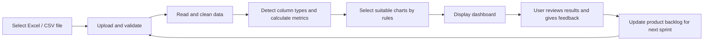
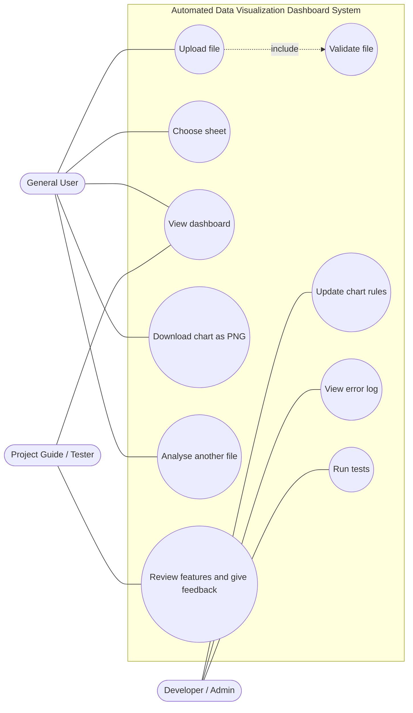
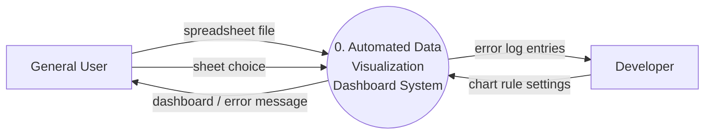
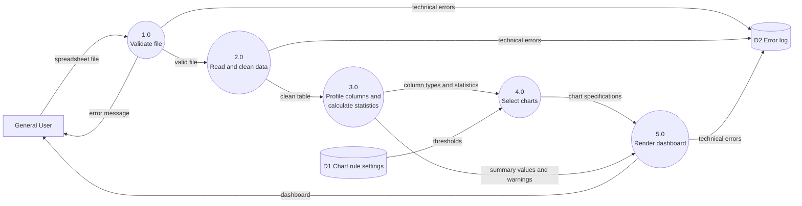
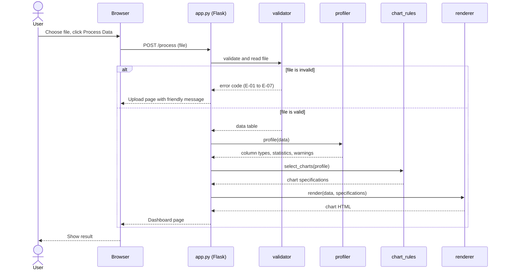

# Software Requirements Specification

## Automated Data Visualization Dashboard System

| | |
|---|---|
| **Version** | 0.2 – Revised Agile Draft |
| **Date** | 10 October 2026 |


> This SRS follows the Agile model. Requirements may be added, changed or removed after each sprint review and feedback session. Requirement IDs are never renumbered or reused, so references stay valid across versions.

---

## Table of Contents

- [Revision History](#revision-history)
- [1. Introduction](#1-introduction)
- [2. Overall Description](#2-overall-description)
- [3. External Interface Requirements](#3-external-interface-requirements)
- [4. System Features](#4-system-features)
- [5. Nonfunctional Requirements](#5-nonfunctional-requirements)
- [6. Other Requirements](#6-other-requirements)
- [Appendix A: Glossary](#appendix-a-glossary)
- [Appendix B: Analysis Models](#appendix-b-analysis-models)
- [Appendix C: Traceability Matrix](#appendix-c-traceability-matrix)
- [Appendix D: To Be Determined List](#appendix-d-to-be-determined-list)

---

## Revision History

| Version | Date | Description of Changes |
|---|---|---|
| 0.1 | — | Initial Agile draft. |
| 0.2 | 10 Oct 2026 | Added the missing sections (Revision History, 1.2 Document Conventions, 1.3 Intended Audience). Resolved the TBDs for web framework, chart library, maximum file size and export formats. Made vague requirements measurable (pie chart limit, performance targets, screen size, totals). Added column-type detection rules, chart selection thresholds, multi-sheet Excel and CSV encoding/delimiter handling, ID column detection, a chart limit, data preview and column information table. Added an error message catalogue, security requirements, user stories with acceptance criteria, Definition of Done, test file set, traceability matrix, and use case, DFD and sequence diagrams. |

---

## 1. Introduction

### 1.1 Purpose

This document specifies the software requirements for the **Automated Data Visualization Dashboard System**. The system lets a user upload a spreadsheet and automatically receive summaries, key values and several suitable charts on one dashboard, without building each graph by hand.

This version (0.2) refines the initial draft. It will continue to change after sprint reviews.

### 1.2 Document Conventions

- **Requirement keywords:**
  - **shall** – mandatory; the release is not accepted without it.
  - **should** – strongly desired; may be deferred with a reason.
  - **may** – optional.
- **Requirement IDs:**
  - `FR-xx` functional requirement
  - `NFR-xx` nonfunctional requirement
  - `BR-xx` business rule
  - `US-xx` user story
  - `E-xx` error message
  - `TF-xx` test file
- **Priority:** High (needed for the first working version), Medium (wanted, can move to a later sprint), Low (nice to have).
- **Status:** Planned, Backlog, Future, Decided, Done.
- **Change column:** **New** = added in v0.2, **Changed** = wording or value changed in v0.2, **—** = unchanged from v0.1.

### 1.3 Intended Audience and Reading Suggestions

| Reader | Suggested sections |
|---|---|
| Project guide / examiner | 1, 2, 4 (FR tables), 5, Appendix B and C |
| Developers | 3, 4 (all detail, especially 4.2.3 and 4.3.2), 5.3, 6.4–6.6 |
| Testers | 4 (FR tables and error catalogue), 5, 6.2–6.4, Appendix C |
| Sample users | 1.4, 2.2, 3.1 |

### 1.4 Product Scope

Many people have large Excel or CSV files but do not know which calculations or charts suit their data. The system reads a file, detects the type of each column, calculates useful values, selects several suitable charts using fixed rules, and shows everything on one simple dashboard.

The first version uses programmed rules to choose charts. An AI-based recommendation feature may be added later, but **the core system must work fully without AI**.

**In scope (first release):**
- Uploading and validating .xlsx, .xls and .csv files
- Column type detection and summary statistics
- Rule-based selection of multiple charts
- A single-page dashboard
- PNG export of charts

**Out of scope (first release):**
- User accounts and login
- Saving past reports or a database
- Editing data inside the app
- Online hosting
- PDF export
- AI recommendations

### 1.5 References

- IEEE-style "Software Requirements Specification" sample format provided for the course.
- Project problem statement: automated visualization of large spreadsheet data.
- Agile process model write-up prepared for this SEM project.
- SRS v0.1 (`docs/SRS_DataVisualisation_v0.1.pdf`).

---

## 2. Overall Description

### 2.1 Product Perspective

The product is a small, self-contained web application. The user opens it in a web browser, uploads a spreadsheet and receives a dashboard. The first version runs on the user's own computer (localhost) and needs no internet connection. A future version may be hosted online.

The existing Jupyter/Python work may be used as an early prototype. The final code will be organised into the modules described in Section 6.6.

### 2.2 Product Functions

- Upload Excel (.xlsx, .xls) or CSV files up to 25 MB.
- Check that the file and its columns are usable, with clear messages when they are not.
- Handle Excel files with several sheets and CSV files with different separators or encodings.
- Detect numeric, text, category, date and ID columns.
- Clean common formatting problems (currency symbols, thousand separators, mixed date formats).
- Calculate count, total, average, median, minimum, maximum and missing values.
- Choose suitable chart types using documented rules, and create up to 10 charts.
- Show summary cards, charts, warnings, a column information table and a data preview on one HTML dashboard.
- Let the user save any chart as a PNG image.
- Never modify the original uploaded file.

### 2.3 User Classes and Characteristics

| User Type | Description | Main Needs |
|---|---|---|
| General User | A student, teacher, analyst or office user with basic computer knowledge. | Upload a file and understand the results without training. |
| Developer / Admin | The person developing and maintaining the system. | Test the system, read error logs, fix errors and update chart rules. |
| Project Guide / Tester | The person checking whether the project meets its requirements. | Review features, test outputs and give feedback at sprint reviews. |

### 2.4 Operating Environment

- Windows 10/11 or a common Linux distribution.
- A current version of Chrome, Edge or Firefox.
- Python 3.10 or later with the libraries listed in Section 3.3.
- The first version runs locally and works without an internet connection.

### 2.5 Design and Implementation Constraints

- Only free and open-source tools are used.
- The core system must not depend on AI or any outside service.
- All chart JavaScript must be served locally (not from a CDN), so the dashboard works offline.
- Chart rules and processing steps must be in separate modules (Section 6.6).
- The user interface must stay simple; technical details are hidden from general users.

### 2.6 User Documentation

- A one-page quick-start guide (`README.md`) explaining installation and use.
- Short instructions on the upload screen (supported types, size limit, first row must be headings).
- Clear error messages (Section 4.7.3) and a short help note on the dashboard explaining each chart type.

### 2.7 Assumptions and Dependencies

- The first non-empty row of each sheet contains column headings.
- The file is not badly damaged. Password-protected files are detected and rejected with a message.
- The computer has at least 8 GB of RAM for files near the 25 MB limit.
- The required Python libraries are installed correctly (a `requirements.txt` file will be provided).
- Dates written as text are assumed to be **day-first** (DD-MM-YYYY), as is common in India.
- Users understand the basic meaning of charts and summary values.

---

## 3. External Interface Requirements

### 3.1 User Interfaces

**Upload screen:**
- Project name and a one-line description.
- A file picker that accepts .xlsx, .xls and .csv, plus a note: "Maximum 25 MB. The first row must contain column headings."
- A **Process Data** button. It stays disabled until a file is chosen.
- A loading indicator shown while the file is processed.
- An area for error messages, written in plain language.

**Dashboard screen (top to bottom):**
1. **Header:** file name, sheet name (with a sheet selector if the file has several sheets), and an **Analyse another file** button.
2. **Summary cards:** total rows, total columns, missing cells (count and %), number of numeric columns, and date range (if a date column exists).
3. **Warnings panel:** missing or unusual data, skipped charts, sampled charts. Hidden when there are no warnings.
4. **Chart grid:** up to 10 charts. Two per row on screens 1200 px or wider, one per row below that. Each chart has a title, axis labels and a one-line caption.
5. **Column information table:** column name, detected type, missing count and %, unique values.
6. **Data preview:** the first 10 rows of the data.

All buttons and messages use clear, non-technical words.

### 3.2 Hardware Interfaces

No special hardware is required. The system uses a normal computer, keyboard, mouse or touchpad, display and local storage. A faster processor and more memory help with large files.

### 3.3 Software Interfaces

| Component | Choice | Purpose | Status |
|---|---|---|---|
| Language | Python 3.10+ | All processing logic | Decided |
| Web framework | **Flask** | Upload handling, routes and HTML templates | Decided (was TBD) |
| Data processing | pandas 2.2+ | Reading and analysing data | Decided |
| .xlsx reading | python-calamine (preferred), openpyxl (fallback) | Calamine is much faster on large files | Decided |
| .xls reading | xlrd | Legacy Excel files | Decided |
| CSV detection | Python `csv.Sniffer`, charset detection | Detect separator and encoding | Decided |
| Charts | **Plotly** (Python) with local plotly.js | Interactive charts with built-in PNG download | Decided (was TBD) |
| Templates | Jinja2 (included with Flask) | Dashboard HTML, with automatic escaping | Decided |
| Testing | pytest | Unit and integration tests | Decided |
| Front end | HTML, CSS, a small amount of JavaScript | Dashboard layout and loading indicator | Decided |

### 3.4 Communication Interfaces

- The browser and the Python application communicate over HTTP on the local machine (`http://127.0.0.1:5000`).
- By default the server listens on `127.0.0.1` only, so other computers on the network cannot reach it.
- The local version uses no email, cloud storage or outside internet service.
- If the system is hosted online later, HTTPS and user access control will be required.

---

## 4. System Features

The following features form the product backlog. Details may change after sprint reviews.

### 4.1 File Upload and Validation

#### 4.1.1 Description and Priority

The user uploads a spreadsheet. The system checks the file before analysing it. **Priority: High.**

#### 4.1.2 User Action and System Response

1. The user chooses an Excel or CSV file.
2. The user clicks **Process Data**.
3. The system checks the file type, size and basic structure.
4. For a multi-sheet Excel file, the system picks the first non-empty sheet.
5. The system accepts the file and continues, or shows a clear error message (Section 4.7.3).

#### 4.1.3 Functional Requirements

| ID | Requirement | Priority | Status | Change |
|---|---|---|---|---|
| FR-01 | The system shall allow the user to select an .xlsx, .xls or .csv file. | High | Planned | — |
| FR-02 | The system shall reject unsupported file types, checking both the file extension and that the content can be opened as that type. | High | Planned | Changed |
| FR-03 | The system shall check that the file contains a heading row, at least one data row and at least one column. | High | Planned | Changed |
| FR-04 | The system shall show a simple message when the file cannot be read. | High | Planned | — |
| FR-05 | The maximum file size shall be **25 MB**. Larger files shall be rejected before they are loaded into memory. | High | Planned | Changed |
| FR-34 | For Excel files with several sheets, the system shall analyse the first non-empty sheet by default, show the sheet name, and let the user switch to another sheet. | High | Planned | New |
| FR-35 | For CSV files, the system shall detect the separator (comma, semicolon, tab or pipe) and the encoding (UTF-8, UTF-8 with BOM, or Windows-1252). | High | Planned | New |
| FR-36 | The system shall reject files with more than 1,000,000 data rows and show a message. | Medium | Planned | New |
| FR-37 | The system shall detect password-protected files and show a specific message. | Medium | Planned | New |
| FR-38 | The system shall trim spaces from headings, rename blank headings to "Column N", and add a suffix (_2, _3) to duplicate headings. | Medium | Planned | New |

### 4.2 Data Processing and Summary

#### 4.2.1 Description and Priority

The system reads the data, cleans common formatting problems, identifies column types and calculates summary values. **Priority: High.**

#### 4.2.2 Functional Requirements

| ID | Requirement | Priority | Status | Change |
|---|---|---|---|---|
| FR-06 | The system shall count the number of rows and columns. | High | Planned | — |
| FR-07 | The system shall classify each column as numeric, date, category, text, ID or empty, using the rules in Section 4.2.3. | High | Planned | Changed |
| FR-08 | The system shall count missing values per column and in total. Empty cells, cells with only spaces, and the values "NA", "N/A", "null", "none" and "-" (any case) shall count as missing. | High | Planned | Changed |
| FR-09 | For numeric columns, the system shall calculate count, average, minimum and maximum. | High | Planned | — |
| FR-10 | The system shall calculate totals only when a total is meaningful, using the rule in Section 4.2.4. | Medium | Planned | Changed |
| FR-11 | The system shall not change the original uploaded file. | High | Planned | — |
| FR-39 | For numeric columns, the system should also calculate the median and standard deviation. | Medium | Planned | New |
| FR-40 | The system shall convert numbers stored as text into numbers by removing currency symbols (₹, $, €, £), thousand separators, % signs and spaces. | High | Planned | New |
| FR-41 | The system shall recognise Excel date cells and common text date formats (DD-MM-YYYY, DD/MM/YYYY, YYYY-MM-DD, "12 Jan 2026"). Text dates shall be read day-first. | Medium | Planned | New |
| FR-42 | The system shall exclude ID columns from statistics and charts, but list them in the column information table. | High | Planned | New |
| FR-43 | The system shall ignore completely empty rows and columns during analysis and report how many were ignored as a warning. | Medium | Planned | New |

#### 4.2.3 Column Type Detection Rules

Rules are applied to non-missing values, in this order. The first rule that matches decides the type.

| Order | Type | Rule |
|---|---|---|
| 1 | **Empty** | More than 95% of values are missing. The column is flagged in warnings and skipped. |
| 2 | **Date** | The column has an Excel date type, or at least 90% of values can be read as dates. |
| 3 | **ID** | All values are unique, there are at least 20 rows, **and** either the column name contains "id", "no", "number", "code" or "roll", or the values are consecutive whole numbers. |
| 4 | **Numeric** | At least 90% of values can be read as numbers after the cleaning in FR-40. |
| 5 | **Category** | 20 or fewer unique values, **and** unique values are less than 50% of rows. Columns with exactly two values (Yes/No, M/F) are categories. |
| 6 | **Text** | Anything else (names, comments, addresses). Counted in the summary but not charted. |

A column where 50–90% of values are numbers is reported in warnings as "mixed numbers and text".

#### 4.2.4 Meaningful Total Rule

A total is shown for a numeric column **unless**:
- it is an ID column, or
- the values are whole numbers between 1900 and 2100 and the column name contains "year", or
- the column name contains "%", "percent", "rate", "ratio", "avg", "average", "mean" or "age".

### 4.3 Chart Selection and Generation

#### 4.3.1 Description and Priority

The system chooses suitable charts using fixed, documented rules. It creates a group of charts that describes the whole dataset, not just one graph. **Priority: High.**

#### 4.3.2 Chart Rules

| Rule | Chart | Used when | Details |
|---|---|---|---|
| R1 | **Line chart** | A date column and a numeric column exist. | The numeric value is totalled per date (or averaged, if a total is not meaningful under 4.2.4) and sorted by date. If there are more than 100 distinct dates, values are grouped by month. |
| R2 | **Bar chart** | A category column exists. | Shows the total (or average) of a numeric column per category, sorted from highest to lowest. With no numeric column, it shows the count per category. |
| R3 | **Pie chart** | A category column has **2 to 6** categories, and the values are counts or meaningful totals with no negative numbers. | Otherwise rule R2 is used instead. |
| R4 | **Histogram** | A numeric column has at least 10 unique values. | Shows how the values are spread. Bin count is chosen automatically. |
| R5 | **Scatter plot** | Two numeric columns have a correlation of at least 0.5 (positive or negative). | At most the 2 strongest pairs are shown. |
| R6 | **Correlation heatmap** | There are 3 or more numeric columns. | Shows how strongly each pair of numeric columns is related. |

#### 4.3.3 Chart Priority and Limit

Candidate charts are generated in the order R1 → R2 → R5 → R4 → R3 → R6. The first 10 are shown, with at most 3 of any one chart type. When there are several category or numeric columns, the ones with the fewest missing values are used first.

#### 4.3.4 Functional Requirements

| ID | Requirement | Priority | Status | Change |
|---|---|---|---|---|
| FR-12 | The system shall select chart types using the rules in Section 4.3.2. | High | Planned | Changed |
| FR-13 | The system shall generate more than one chart when the data supports it. | High | Planned | — |
| FR-14 | The system shall not use a pie chart for more than 6 categories. | High | Planned | Changed |
| FR-15 | Every chart shall have a clear title and labelled axes, including units where known. | High | Planned | — |
| FR-16 | Line charts should mark the highest and lowest points, and bar charts should highlight the largest bar. | Medium | Planned | Changed |
| FR-17 | The system shall skip a chart when the data is not suitable for it, and list skipped charts in the warnings panel. | High | Planned | Changed |
| FR-44 | The system shall show no more than 10 charts, following the priority in Section 4.3.3. | High | Planned | New |
| FR-45 | Scatter plots with more than 5,000 points shall show a random sample of 5,000 points. Statistics shall still use all rows, and the chart shall say it is a sample. | Medium | Planned | New |
| FR-46 | Bar charts with more than 15 categories shall show the top 15 and note how many categories were left out. | Medium | Planned | New |
| FR-47 | The system should show a correlation heatmap when there are 3 or more numeric columns. | Medium | Planned | New |
| FR-48 | Each chart should have a one-line caption explaining why it was chosen, for example "Compares total Sales across 5 Regions." | Medium | Planned | New |

### 4.4 Dashboard Display

#### 4.4.1 Description and Priority

All results are shown together on one dashboard so the user can understand the file quickly. **Priority: High.**

#### 4.4.2 Functional Requirements

| ID | Requirement | Priority | Status | Change |
|---|---|---|---|---|
| FR-18 | The dashboard shall show the uploaded file name and, for Excel files, the sheet name. | High | Planned | Changed |
| FR-19 | The dashboard shall show summary cards for total rows, total columns, missing cells (count and %), number of numeric columns, and date range when a date column exists. | High | Planned | Changed |
| FR-20 | The dashboard shall show charts in a grid: two per row at 1200 px width or more, one per row below that. | High | Planned | Changed |
| FR-21 | The dashboard shall be readable at 1366 × 768 without horizontal scrolling. | High | Planned | Changed |
| FR-22 | The dashboard should let the user choose a column or chart. | Medium | Backlog | — |
| FR-23 | The dashboard should show warnings for: columns with more than 20% missing values, empty columns, mixed-type columns, ignored rows or columns, skipped charts and sampled charts. | Medium | Planned | Changed |
| FR-49 | The dashboard shall show a column information table with name, detected type, missing count and %, and number of unique values. | High | Planned | New |
| FR-50 | The dashboard should show a preview of the first 10 rows of the data. | Medium | Planned | New |
| FR-51 | The dashboard shall have an "Analyse another file" button that returns to the upload screen. | High | Planned | New |

### 4.5 Export Results

#### 4.5.1 Description and Priority

The user may want to save charts or the dashboard. **Priority: Medium.**

#### 4.5.2 Functional Requirements

| ID | Requirement | Priority | Status | Change |
|---|---|---|---|---|
| FR-24 | The system shall allow each chart to be saved as a PNG image, using the chart's built-in download button. | Medium | Planned | Changed |
| FR-25 | The system may allow the whole dashboard to be downloaded as a single self-contained HTML file. | Low | Backlog | Changed |
| FR-26 | PDF export is not included in the first release. It will be reconsidered after user feedback. | Low | Decided | Changed |

### 4.6 Optional AI Recommendation

#### 4.6.1 Description and Priority

An AI feature may later suggest extra charts or explain why a chart was chosen. The project does not depend on it. **Priority: Low / Future.**

#### 4.6.2 Functional Requirements

| ID | Requirement | Priority | Status | Change |
|---|---|---|---|---|
| FR-27 | The core dashboard shall work fully when the AI feature is unavailable or turned off. | High | Planned | — |
| FR-28 | The AI feature may suggest additional chart types. | Low | Future | — |
| FR-29 | The user should be able to ignore an AI suggestion. AI suggestions shall be labelled and never replace rule-based charts. | Low | Future | Changed |
| FR-52 | If an AI feature uses an outside service, it shall send only column names, types and summary statistics (never data rows), and only after the user agrees. | Low | Future | New |

### 4.7 Error Handling

#### 4.7.1 Description and Priority

The system handles common problems without crashing. **Priority: High.**

#### 4.7.2 Functional Requirements

| ID | Requirement | Priority | Status | Change |
|---|---|---|---|---|
| FR-30 | The system shall show a useful message for an empty, damaged or unsupported file, using the messages in Section 4.7.3. | High | Planned | Changed |
| FR-31 | The system shall handle missing values without stopping the whole process. | High | Planned | — |
| FR-32 | The system shall record technical errors (time, file name, error type, full details) in `logs/app.log`. These details shall never be shown to general users. | Medium | Planned | Changed |
| FR-33 | The system shall allow the user to try another file after an error. | High | Planned | — |
| FR-53 | A failure while analysing one column or drawing one chart shall not stop the rest of the dashboard. The failed item shall be listed in the warnings panel. | High | Planned | New |

#### 4.7.3 Error Message Catalogue

| Code | Condition | Message shown to the user |
|---|---|---|
| E-01 | Unsupported file type | "This file type isn't supported. Please upload an .xlsx, .xls or .csv file." |
| E-02 | File larger than 25 MB | "This file is larger than 25 MB. Please upload a smaller file or split it into parts." |
| E-03 | No data rows or no columns | "This file has no data. Make sure the first row has column headings and there is at least one row of data below it." |
| E-04 | File damaged or unreadable | "We couldn't read this file. It may be damaged. Try opening it in Excel, saving it again, and uploading it." |
| E-05 | Password-protected file | "This file is password-protected. Please remove the password in Excel and upload it again." |
| E-06 | More than 1,000,000 rows | "This file has more than 1,000,000 rows, which is above the current limit." |
| E-07 | Process clicked with no file | "Please choose a file first." |
| E-08 | No chartable columns (warning, not error) | "No charts could be made because no columns contain numbers, dates or categories. The summary and column table are still shown." |
| E-09 | Unexpected error | "Something went wrong while processing this file. Please try again or use a different file." (Details are written to the log.) |

---

## 5. Nonfunctional Requirements

**Reference laptop:** Intel Core i5 / AMD Ryzen 5 (or similar), 8 GB RAM, SSD, Windows 11.

### 5.1 Performance Requirements

| ID | Requirement |
|---|---|
| NFR-01 | A file of 50,000 rows × 30 columns (about 5 MB) shall be processed in 30 seconds or less on the reference laptop. Target: 10 seconds. |
| NFR-02 | A 25 MB file shall be processed in 60 seconds or less on the reference laptop. |
| NFR-03 | The dashboard shall finish displaying within 5 seconds after processing completes. |
| NFR-04 | A loading indicator shall appear within 1 second of clicking Process Data. |

### 5.2 Safety Requirements

| ID | Requirement |
|---|---|
| NFR-05 | The original uploaded file shall never be edited, moved or deleted. The system works only on a copy in memory. |

### 5.3 Security Requirements

| ID | Requirement |
|---|---|
| NFR-06 | The local version shall not send uploaded data to any outside service. |
| NFR-07 | Uploaded files shall be processed in memory. If a temporary file is needed, it shall be deleted once processing ends, including when an error occurs. |
| NFR-08 | Uploaded file names shall be cleaned (for example with Flask's `secure_filename`) before use. |
| NFR-09 | The upload size limit shall be enforced by the server (Flask `MAX_CONTENT_LENGTH`), not only by the browser. |
| NFR-10 | Any text from the spreadsheet shown on the dashboard (headings, values) shall be HTML-escaped, so that a cell containing HTML or script code cannot run in the browser. |
| NFR-11 | The server shall listen only on `127.0.0.1` by default. |
| NFR-12 | If the system is hosted online later, user access control and HTTPS shall be required. |

### 5.4 Software Quality Attributes

| ID | Quality | Requirement | How it is checked |
|---|---|---|---|
| NFR-13 | Ease of use | A new user can upload a file and view the dashboard without help. | At least 2 sample users complete the task unaided in under 2 minutes. |
| NFR-14 | Correctness | Summary values match the data. | Values for the test files match manual calculations in Excel, rounded to 2 decimal places. |
| NFR-15 | Reliability | A problem in one column does not stop other results (see FR-53). | Test file TF-07 produces a dashboard with warnings and no crash. |
| NFR-16 | Maintainability | Validation, profiling, chart rules and rendering are separate modules. Chart rule thresholds are kept in one configuration place. | Code review against Section 6.6. |
| NFR-17 | Compatibility | The dashboard works on current Chrome, Edge and Firefox. | Manual check in all three browsers. |
| NFR-18 | Testability | Core functions can be tested with small sample files, without starting the web server. | pytest suite runs in under 60 seconds. |

### 5.5 Business Rules

| ID | Rule |
|---|---|
| BR-01 | Only .xlsx, .xls and .csv files may be processed. |
| BR-02 | The original uploaded file must remain unchanged. |
| BR-03 | A pie chart must not be used for more than 6 categories. |
| BR-04 | Easy-to-read charts are preferred over decorative ones (no 3D charts). |
| BR-05 | The optional AI feature must not block or replace the rule-based system. |
| BR-06 | ID columns are never averaged, totalled or charted. |

---

## 6. Other Requirements

### 6.1 Agile Development Plan

The project is developed in sprints of about two weeks. At the start of each sprint, requirements are chosen from the backlog. At the end, the working result is shown to the guide or sample users, and their feedback updates this SRS.

| Sprint | Goal | Main requirements |
|---|---|---|
| 1 | Upload, validation and reading files | FR-01 to FR-05, FR-11, FR-34 (default sheet), FR-35, FR-36, FR-38, NFR-08, NFR-09 |
| 2 | Column detection, statistics and chart rules (tested without the UI) | FR-06 to FR-10, FR-12 to FR-17, FR-39 to FR-48 |
| 3 | Dashboard design and multiple charts | FR-18 to FR-21, FR-23, FR-24, FR-34 (sheet selector), FR-49 to FR-51, NFR-10 |
| 4 | Error handling, testing and improvements | FR-30 to FR-33, FR-37, FR-53, NFR-01 to NFR-04, NFR-13 to NFR-18 |
| Later | Dashboard HTML export, column selection, optional AI | FR-22, FR-25, FR-27 to FR-29, FR-52 |

### 6.2 User Stories and Acceptance Criteria

**US-01 – Upload a file**
_As a general user, I want to upload my spreadsheet so that I can see charts without making them myself._
- Given a valid .csv, .xlsx or .xls file under 25 MB, when I click Process Data, then the dashboard is shown.
- Given a .pdf file, when I click Process Data, then I see message E-01 and stay on the upload screen.

**US-02 – Understand bad files**
_As a general user, I want clear messages when my file has a problem so that I know how to fix it._
- Given an empty, damaged, password-protected or oversized file, when I upload it, then I see the matching message from Section 4.7.3 and no technical error text.
- After any error, I can choose another file without restarting the app.

**US-03 – See key numbers**
_As a general user, I want summary cards so that I can see the size and quality of my data at a glance._
- The dashboard shows rows, columns, missing cells and numeric column count, and these match the file.

**US-04 – Get suitable charts**
_As a general user, I want the system to pick sensible charts so that I don't have to know which chart to use._
- Given a file with a date column and a numeric column, a line chart is shown.
- Given a category column with 4 values, a bar chart is shown and a pie chart may be shown.
- Given a category column with 12 values, no pie chart is shown for it.
- No more than 10 charts are shown.

**US-05 – Choose a sheet**
_As a general user with a multi-sheet Excel file, I want to pick which sheet to analyse._
- The first non-empty sheet is analysed by default, and its name is shown.
- Choosing another sheet from the selector refreshes the dashboard for that sheet.

**US-06 – Save a chart**
_As a general user, I want to save a chart as an image so that I can put it in a report._
- Clicking the chart's download button saves a PNG file that shows the full chart with its title.

**US-07 – Trust the data**
_As a general user, I want to see warnings and a data preview so that I know the file was read correctly._
- Columns with more than 20% missing values appear in the warnings panel.
- The first 10 rows are shown and match the original file.

**US-08 – Fix problems**
_As a developer, I want technical errors logged so that I can fix problems users report._
- When an unexpected error occurs, an entry with time, file name and error details is added to `logs/app.log`.

### 6.3 Definition of Done

A backlog item is **Done** when:
1. The code is written and merged into the main project.
2. The related acceptance criteria (Section 6.2) pass.
3. Automated tests for the item are written and all tests pass.
4. It has been checked manually with at least one file from the test set (Section 6.4).
5. It has been shown at a sprint review.
6. Its status in this SRS is updated.

### 6.4 Testing Requirements

- Unit tests (pytest) for validation, column detection, statistics and chart rules, run without the web server.
- Integration tests that upload each test file to the Flask app and check the response.
- Summary values checked against manual calculations in Excel.
- Chart choices checked against the rules in Section 4.3.2.
- At least two sample users test the dashboard and give feedback (NFR-13).

**Test file set:**

| ID | Test file | Expected result |
|---|---|---|
| TF-01 | Small clean CSV (20 rows: date, category, two numeric columns) | Dashboard with line, bar, histogram and pie charts; values match Excel |
| TF-02 | Empty CSV (0 bytes) | E-03 |
| TF-03 | CSV with headings only | E-03 |
| TF-04 | A PDF renamed to .csv | E-01 or E-04, no crash |
| TF-05 | Semicolon-separated CSV saved in Windows-1252 encoding with ₹ values | Read correctly; ₹ values detected as numeric |
| TF-06 | Excel file with 3 sheets, the first one empty | Second sheet analysed by default; selector lists all sheets |
| TF-07 | Messy file: mixed date formats, blanks, "N/A", numbers stored as text | Dashboard with warnings, no crash; types detected correctly |
| TF-08 | Category column with 50 categories | No pie chart; bar chart shows top 15 with a note |
| TF-09 | File with a Roll No column (1 to 200) | Roll No detected as ID; not averaged or charted |
| TF-10 | Large file: 50,000 rows × 30 columns | Processed within NFR-01 limits |
| TF-11 | File slightly over 25 MB | E-02, rejected before reading |
| TF-12 | Legacy .xls file | Read correctly |
| TF-13 | Password-protected .xlsx | E-05 |
| TF-14 | Blank and duplicate headings | Headings renamed as in FR-38 |
| TF-15 | Cell containing `<script>alert(1)</script>` | Shown as plain text; script does not run |
| TF-16 | Only text columns (names, comments) | Summary and column table shown; warning E-08 |

### 6.5 Data Storage Requirements

A database is not needed for the first version. Uploaded files are processed in memory and discarded. A database may be considered later only if users need saved projects, login accounts or past reports. The only file the system writes is the developer error log (`logs/app.log`).

### 6.6 Proposed Module Structure

This section is design guidance to support NFR-16 and NFR-18. It is not a strict requirement.

```
app.py            Flask routes only (upload page, process, dashboard)
validator.py      File type, size, structure and password checks; reads the file into a DataFrame
profiler.py       Cleaning, column type detection, statistics, warnings
chart_rules.py    Decides WHICH charts to make; returns a list of chart specifications
renderer.py       Turns chart specifications into Plotly charts
config.py         Thresholds (25 MB, 6 pie slices, 10 charts, 5,000 sample points, ...)
templates/        upload.html, dashboard.html
static/           CSS and local plotly.js
tests/            pytest tests and the test file set (Section 6.4)
logs/             app.log
```

`chart_rules.py` returns plain data, not drawings. For example:

```json
[
  {"type": "line", "x": "Order Date", "y": "Sales", "agg": "sum", "rule": "R1"},
  {"type": "bar",  "x": "Region",     "y": "Sales", "agg": "sum", "rule": "R2"}
]
```

Keeping the decision separate from the drawing means the chart rules can be unit tested without rendering anything. It also means a future AI feature (Section 4.6) could be added as a second source of chart specifications without changing the rest of the system.

---

## Appendix A: Glossary

| Term | Meaning |
|---|---|
| Acceptance criteria | Conditions a feature must meet to be accepted, written as checkable statements. |
| Agile | A way of developing software in small steps, improving it through regular feedback. |
| Category column | A column with a small number of repeated values, such as Region or Gender. |
| Correlation | A number from -1 to 1 showing how strongly two numeric columns move together. |
| CSV | A text file that stores table data with values separated by a character such as a comma. |
| Dashboard | A screen that shows important values and charts together. |
| Dataset | A collection of data arranged in rows and columns. |
| Definition of Done | The checklist a backlog item must pass before it counts as finished. |
| Encoding | The way text characters are stored in a file (for example UTF-8). |
| Functional requirement | A task or action the system must perform. |
| ID column | A column that uniquely identifies each row, such as Roll No or Order ID. |
| Metric | A measured value such as total, average, minimum or maximum. |
| Nonfunctional requirement | A quality requirement such as speed, ease of use or security. |
| Product backlog | A changing list of features and improvements planned for future sprints. |
| Sampling | Using a random subset of rows to draw a chart faster. |
| Sprint | A short, fixed period (about two weeks) in which a set of backlog items is built. |
| TBD | To Be Determined; a detail that will be decided later. |
| User story | A short description of a feature from the user's point of view. |
| Validation | Checking whether an input file is acceptable before using it. |

---

## Appendix B: Analysis Models

> The diagrams below use Mermaid syntax. They render in VS Code's Markdown preview (with a Mermaid extension), on GitHub and in most Markdown viewers.

### B-1 System Workflow and Agile Feedback Loop



### B-2 Use Case Diagram



### B-3 Data Flow Diagram – Level 0 (Context Diagram)



### B-4 Data Flow Diagram – Level 1



### B-5 Sequence Diagram – Upload to Dashboard



---

## Appendix C: Traceability Matrix

| Requirement | Sprint | Verified by |
|---|---|---|
| FR-01, FR-02 | 1 | TF-01, TF-04, TF-12 |
| FR-03 | 1 | TF-02, TF-03 |
| FR-04, FR-30 | 1, 4 | TF-04, TF-13 |
| FR-05, NFR-09 | 1 | TF-11 |
| FR-06, FR-09, FR-10, FR-39 | 2 | TF-01 (manual check in Excel) |
| FR-07, FR-40, FR-41 | 2 | TF-05, TF-07 |
| FR-08, FR-31 | 2 | TF-07 |
| FR-11, NFR-05 | 1 | All test files (file hash unchanged after processing) |
| FR-12, FR-13 | 2 | TF-01, US-04 |
| FR-14, BR-03, FR-46 | 2 | TF-08 |
| FR-15, FR-16, FR-48 | 2, 3 | TF-01 (visual check) |
| FR-17, FR-23 | 2, 3 | TF-07, TF-16 |
| FR-18 to FR-21 | 3 | TF-01, check at 1366 × 768 |
| FR-24 | 3 | US-06 |
| FR-32 | 4 | Forced error test, US-08 |
| FR-33, FR-51 | 3, 4 | US-02 |
| FR-34 | 1, 3 | TF-06 |
| FR-35 | 1 | TF-05 |
| FR-36 | 1 | Generated file with over 1,000,000 rows |
| FR-37 | 4 | TF-13 |
| FR-38 | 1 | TF-14 |
| FR-42, BR-06 | 2 | TF-09 |
| FR-43 | 2 | TF-07 |
| FR-44, FR-45 | 2 | TF-10 |
| FR-47 | 2 | TF-10 |
| FR-49, FR-50 | 3 | TF-01, US-07 |
| FR-53, NFR-15 | 4 | TF-07 |
| NFR-01, NFR-02 | 4 | TF-10, file of about 25 MB |
| NFR-03, NFR-04 | 4 | Timed manual test |
| NFR-06, NFR-11 | 1 | Code review; run with network disconnected |
| NFR-07, NFR-08 | 1 | Code review |
| NFR-10 | 3 | TF-15 |
| NFR-13 | 4 | Sample user test |
| NFR-14 | 2 | TF-01 compared with Excel |
| NFR-17 | 4 | Manual check in Chrome, Edge and Firefox |
| NFR-18 | All | pytest run time |

---

## Appendix D: To Be Determined List

**Resolved in v0.2:**

| Item | Decision |
|---|---|
| Maximum file size | 25 MB and 1,000,000 rows (FR-05, FR-36) |
| Web framework | Flask (Section 3.3) |
| Chart library | Plotly with local plotly.js (Section 3.3) |
| Export formats | PNG per chart in the first release; HTML dashboard later; no PDF (FR-24 to FR-26) |
| Final performance limits | NFR-01 to NFR-04; to be confirmed by Sprint 4 testing |

**Still open:**

1. Whether column and chart selection (FR-22) will be in the first release. Decide at the Sprint 3 review.
2. Whether the optional AI recommendation feature (Section 4.6) will be built, and with which service.
3. Whether the detection thresholds in 4.2.3 and 4.3.2 (20 categories, 90% rule, 0.5 correlation) need adjusting after testing with real user files.
4. Whether the system will be hosted online after the first release.
