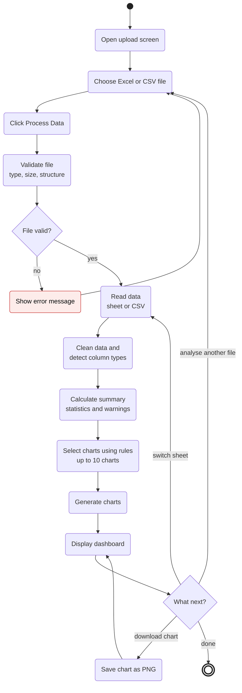
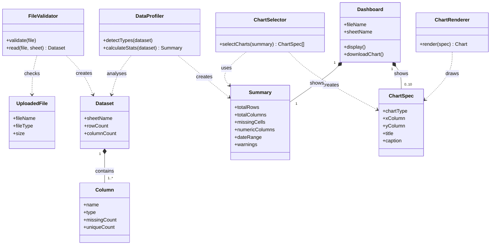

# Simplified Activity and Class Diagrams

## Automated Data Visualization Dashboard System

One activity diagram and one class diagram for the whole system, based on SRS v0.2. For the detailed versions, see `Activity_and_Class_Diagrams.md`.

Image copies are in `docs/diagrams/` (`Simplified_Activity_Diagram.png`, `Simplified_Class_Diagram.png`).

---

## 1. Activity Diagram

| Step | Requirements |
|---|---|
| Choose file, Process Data | FR-01, US-01 |
| Validate file, show error | FR-02 to FR-05, FR-30, FR-33 |
| Read data | FR-34, FR-35, FR-38 |
| Clean data, detect types | FR-07, FR-08, FR-40 to FR-43 |
| Summary statistics and warnings | FR-06, FR-09, FR-10, FR-23, FR-39 |
| Select and generate charts | FR-12 to FR-17, FR-44 to FR-48 |
| Display dashboard | FR-18 to FR-21, FR-49 to FR-51 |
| Save chart as PNG | FR-24 |

---

## 2. Class Diagram

| Class | Role | Module (SRS 6.6) |
|---|---|---|
| UploadedFile | The file the user uploads. Never changed. | — |
| FileValidator | Checks the file and reads it into a table. | validator.py |
| Dataset, Column | The data table and its columns. | — |
| DataProfiler | Detects column types and calculates statistics. | profiler.py |
| Summary | Figures for the summary cards, plus warnings. | — |
| ChartSelector | Picks charts using rules R1 to R6. | chart_rules.py |
| ChartSpec | One chosen chart: type, columns, title, caption. | — |
| ChartRenderer | Draws each chart with Plotly. | renderer.py |
| Dashboard | The page the user sees. | app.py, templates |
